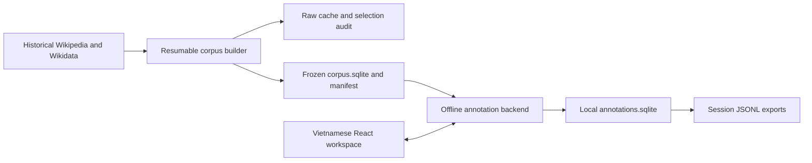

# Vietnamese Multi-hop Fact-Checking Implementation Plan

> **For implementers:** Read [specs.md](specs.md) and [docs.md](docs.md) first. Use the `executing-plans` workflow for inline implementation; do not begin implementation as part of writing this plan. Milestone checkboxes below are planning handoff items; detailed dependency-ordered work will be generated separately in `tasks.md`.

**Goal:** Build a reproducible 20,000-article fixed Vietnamese Wikipedia lead corpus and a Windows-local application for human-authored fact-checking samples.

**Architecture:** Separate an internet-enabled corpus builder from an offline annotation application. The builder keeps revision-addressed raw data and resumable stage results, then publishes a validated, immutable corpus package. The annotation backend reads that package and writes independent samples/session records; the frontend keeps only transient workspace state.

**Tech stack:** Python 3.12 baseline, FastAPI, Pydantic, HTTPX, Python `sqlite3`, mwparserfromhell, React, TypeScript, Vite, PowerShell, pytest, and Playwright. Use a currently supported Node.js LTS compatible with the selected Vite release; lock exact package versions during setup after a compatibility smoke test rather than inventing version guarantees here.

**Spec:** [specs.md](specs.md)  
**Status:** Design complete; implementation and real-data validation have not been performed.  
**Feature directory:** `docs/`  
**Branch:** None; the current workspace is not an initialized git repository.

## Global Constraints

- Initial collection target: **80,000 Vietnamese Wikipedia candidates**; extend collection if necessary, never lower quality to fill the corpus.
- Frozen corpus: exactly **20,000 unique eligible articles**; primary-group quotas are soft.
- One fixed UTC snapshot for Wikipedia, Wikidata, classification dependencies, identity resolution, and resumed work.
- Full Lead prose only: preserve all introductory paragraphs, exclude body/infobox/table/navigation/reference material; initially display **six sentences**.
- Graph edges come only from real hyperlinks in retained Full Lead prose. Full-article links are separate audit data, not operational graph edges.
- Labels and hop counts remain human-selected. SUPPORTED/REFUTED: 2 or 3 hops and at least two distinct sentences, with no minimum document count. NEI: 2 hops and exactly one partial sentence.
- Cross-document evidence is preferred, not mandatory. Derived coverage is descriptive, not a semantic validator.
- No annotation review workflow, NEI search/review UI, review metadata, annotator IDs, date export, or draft restoration.
- Each page opening/refresh starts a new UUID session and empty workspace; successful samples survive refresh and restart.
- Only `Export Dataset` for the current session in the UI; commands recover older sessions.
- No LLM, Cross-Encoder, Docker, or Agentic RAG implementation in this delivery.
- Pilot validation is staged at **100 -> 1,000 -> 10,000 candidates** using the fixed snapshot. Production collection requires a reported pilot assessment, no unresolved critical defects, and the user's explicit decision to continue; it never starts automatically after a pilot.

## Review Focus

1. Historical page rendering can expand current templates despite `oldid`: test that unresolved content-generating templates never introduce current prose or links.
2. Current title/redirect or Wikidata association can disagree with the snapshot: test snapshot identity proofs and reject ambiguous graph/classification mappings.
3. Network ordering and interrupted writes can change rankings: test deterministic replay, stable tie-breaking, and resume after failure at each stage boundary.
4. A committed Submit can lose its acknowledgement: test identical retry, conflicting retry, double-click, and refresh without duplicate/overwritten samples.
5. Frozen SQLite files can depend on sidecar data or be modified accidentally: test standalone package transfer, read-only connections, byte integrity, and offline startup.

## Technical Context and Repository Assessment

The workspace currently contains requirements/specification documents and no application implementation to reuse. `docs/plans.md` was empty. There is no `.specify` directory, constitution, template stack, extension configuration, or existing agent-context file.

Use the user's explicit `docs/` layout instead of generating a feature branch or another spec tree. Spec Kit research, data model, contracts, and quickstart artifacts are supplied alongside this plan. No absent setup/agent-context script is executed, and no new AGENTS.md is introduced solely for planning.

Planning gates inherited from the agreed requirements:

| Gate | Design result |
| --- | --- |
| Human annotation authority | Pass: server validates structure only; never chooses label/hops |
| Snapshot consistency | Pass by design: raw revision source and historical dependency/identity proof; implementation tests required |
| Lead-only corpus and graph | Pass: one extraction boundary supplies prose and link occurrences |
| Frozen/local annotation | Pass: annotation service has no source-network client dependency |
| External human review | Pass: only external corpus-quality assessment ingestion, no sample review workflow |
| Scope preservation | Pass: future RAG and benchmark semantic validation remain outside delivery |

## Phase 0: Research Decisions

See [research.md](research.md) for decisions, alternatives, and primary-source citations; [research_vimqa.md](research_vimqa.md) records the requested ViMQA comparison.

### Historical acquisition

Use MediaWiki Action APIs for raw acquisition. Resolve each historical revision separately with `prop=revisions`, `rvstart=<snapshot>`, `rvdir=older`, `rvlimit=1`; verify its timestamp. Historical enumeration does not support batching many page histories into one such request. Batch retrieval of known revision contents afterward, initially 20 revision IDs per request, lowering the batch size on response-size/limit errors. Use `rvslots=main` and retain returned content model, source SHA-1, and local SHA-256.

Apply the same revision-selection procedure to Wikidata items and referenced P279/occupation classes. Cache selected revisions by `(site, identity, snapshot)` and raw contents by `(site, revision_id)`. Current pageprops, categories, title lists, and sitelinks can discover candidates; they cannot prove historical content or classification. Validate the selected item's historical sitelink against the article's snapshot title/identity before classifying it.

### Historical rendering decision

`action=parse&oldid=...&prop=links` returns full-page links and does not isolate lead prose. In addition, `oldid` does not pin transcluded template versions. Consequently, API-parsed HTML is optional diagnostic/audit material, not authoritative evidence merely because it was requested with an old revision ID.

The default authoritative extractor works on downloaded historical wikitext through an AST. It removes excluded components, preserves authored prose/explicit wikilinks, and uses versioned local formatters for a small allowlist of understood inline formatting/date templates. Each formatter consumes only raw historical arguments; it performs no live expansion. Content-producing templates outside that allowlist mark the article `unresolved_extraction` and prevent selection, rather than silently dropping factual clauses or substituting current content. A future historical-template renderer would require a new extraction version and pinned dependency closure; it is not the default implementation.

### Network and storage policy

Default external request concurrency is **one per host**, with a shared per-host limiter and explicit User-Agent/contact. Parallelize local extraction with at most two workers initially. Use persistent connections, `maxlag=5`, continuation handling, disk cache, retries, and backpressure. These are configurable engineering defaults, not promised source limits or throughput.

Use one SQLite writer per writable database. Pipeline records and compressed raw blobs are separate from the portable frozen database. For annotation, retain `corpus.sqlite` read-only and write `annotations.sqlite` independently. Never assume copying a database with an outstanding WAL produces a complete standalone package.

## Phase 1: Architecture and File Responsibilities



```text
configs/
  pipeline.json                 Snapshot-independent defaults and soft quotas
  classification_rules.json     Reviewed QID mappings, subtype roots, precedence
  extraction_rules.json         Exclusions, inline-template formatters, split rules
  ranking_rules.json            Signals, integer weights, partner caps
backend/
  pyproject.toml                Python dependencies and executable entry points
  src/vimfc/
    __main__.py                 Enables the documented python -m vimfc commands
    domain.py                   Shared value types; no source-network dependencies
    cli.py                      Builder/status/export command dispatch
    storage/
      pipeline_store.py         Run/stage/checkpoint transactions
      raw_cache.py              Revision-addressed compressed objects
      corpus_store.py           Read-only corpus query interface
      annotation_store.py       Sessions, samples, idempotent writes
      migrations.py             Independently versioned writable schemas
    source/
      mediawiki.py              HTTP requests, continuation, throttling, retries
      revisions.py              Snapshot revision selection and content retrieval
      identities.py             Historical aliases, redirects, move provenance
      wikidata.py               Snapshot items and classification dependencies
    pipeline/
      collect.py                Candidate streams and initial/extension manifests
      extract.py                Lead prose/link AST extraction
      sentences.py              Deterministic Vietnamese sentence segmentation
      classify.py               Rule-based supported group/subtype classification
      quality.py                Eligibility filters and article signals
      pairs.py                  Bounded bridge/comparison candidate generation
      rank.py                   Pair features and fixed-point scoring
      select.py                 Deterministic graph-aware greedy selection
      freeze.py                 Validation, portable DB creation, publication
      report.py                 Progress/ETA and quality report generation
      runner.py                 Stage dependency and checkpoint orchestration
    annotation/
      service.py                Structural validation, authoritative source loading
      export.py                 Common record serializer and JSONL streaming
    api/
      app.py                    Lifespan, read-only corpus validation, router wiring
      schemas.py                Strict request/response models
      sessions.py               Session creation/count endpoints
      articles.py               Local article/random/discovery endpoints
      samples.py                Submit and current-session export endpoints
frontend/
  src/api.ts                    Typed API transport; retry identity handling
  src/workspace.ts              Reducer for ephemeral workspace/draft state
  src/App.tsx                   Session initialization and three-zone layout
  src/components/               ArticleCard, DiscoveryPanel, AnnotationForm, Header
  src/styles.css                Readable Vietnamese UI and selected-sentence state
tests/
  fixtures/                     Archived wikitext/JSON/link and failure fixtures
  unit/                         Extraction, classification, scores, reducer tests
  integration/                  Historical HTTP, storage, freeze, API, CLI tests
  e2e/                          Offline annotation/refresh/export browser tests
scripts/                        Installation and Windows helper scripts
start.ps1                       One-command application launcher
data/
  pipeline.sqlite               Resumable builder database; not annotator package
  raw/                          Compressed source/cache objects and manifests
  corpora/<corpus_version>/      corpus.sqlite and package manifest
  annotations.sqlite            Local submitted samples and sessions
docs/                           Specification, plan, design contracts and run guides
```

Files listed above are proposed implementation outputs, not files already created by this planning turn. Keep source-network code inaccessible through the annotation service dependency graph.

### Shared interfaces

Use explicit value types from `domain.py`:

| Interface | Contract |
| --- | --- |
| `select_revision(site, identity, snapshot) -> SourceRevisionRef` | Return verified historical identity/revision/timestamp or typed unresolved failure |
| `fetch_revisions(site, refs) -> list[RawRevision]` | Retrieve known IDs, verify metadata, persist reusable raw objects |
| `extract_lead(raw, rules) -> LeadExtractionResult` | Prose paragraphs, sentences, retained link occurrences, diagnostics, supported/pending outcome |
| `classify(article_ref, item_history, rules) -> ClassificationResult` | Primary group, subtype IDs, property paths and revision-backed provenance |
| `build_pairs(candidates, lead_links, rules) -> PairManifest` | Bounded reproducible pair identities/features; no human labels/hops |
| `select_corpus(candidates, pairs, rules) -> SelectionManifest` | Exactly 20,000 IDs or insufficient-eligible report; deterministic trace |
| `freeze(run_id, selection, output_path) -> CorpusManifest` | Complete portable package only after validation; never overwrite a version |
| `submit_sample(session_id, submission_id, draft) -> SampleRecord` | Resolve source sentences locally, validate, atomically persist or replay/conflict |
| `export_session(session_id) -> iterator[SampleRecord]` | One common serializer for HTTP download and command export |

The exact fields, relationships, and index choices are defined in [data-model.md](data-model.md). Public command/request/response behavior is defined in [contracts/interfaces.md](contracts/interfaces.md).

## Phase 1A: Corpus Builder Design

### 1. Candidate collection and snapshot manifest

Use round-robin category/subtype seed streams and namespace-zero enumeration as discovery mechanisms; capture all continuation cursors and stream order. Current category memberships only schedule potential pages. Classification and evidence always come from historical source data. Persist a candidate manifest so replay does not depend on a later live enumeration.

Assign deterministic discovery order using a recorded seed and stable digest of normalized page identity, rather than Python's randomized hash. Balance stream scheduling to avoid taking the first 80,000 alphabetically listed pages. Grow the initial manifest to 80,000 unique candidate identities, deduplicating redirect aliases after resolution. If eligible supply is short, add the next persisted stream tranche, initially 10,000 additional unique candidates, with the same run snapshot/rules; repeat or report exhausted supply.

For historical titles or moved pages, use recorded move/redirect revision provenance to establish identity at the snapshot. Current redirect resolution is only a lookup hint. Follow at most ten historical redirect steps, detect cycles, retain original titles/fragments and all resolution revisions, and mark unresolved/ambiguous targets explicitly. Do not invent an edge when identity cannot be established. A run is a reproducible selection from its archived candidate manifest, not a claim to recreate every deleted page in historical Wikipedia.

### 2. Extraction and sentence identity

Determine the lead AST region before the first section heading. Drop infobox/table/list/navigation/reference/media nodes; convert wikilink labels, external-link labels, inline emphasis and HTML entities into prose. Preserve paragraph boundaries and link span-to-sentence associations internally so the graph and text have the same extraction boundary. Text offsets remain internal extraction aids, not annotation/export fields.

Do not drop arbitrary unknown inline templates and call the remaining sentence complete. Resolve only the configured argument-based formatters; otherwise quarantine the candidate for extraction support. Snapshot direct classification categories can be parsed from raw wikitext; template-generated categories do not become historical classification evidence without resolved provenance.

Normalize to Unicode NFC without changing spellings or silently correcting human factual text. Segment using versioned Vietnamese-aware punctuation rules: protect decimals, initials and an explicit abbreviation list; split on sentence-ending punctuation and paragraph boundaries; never split inside protected constructs. Store exact resulting sentence text. Test against archived examples with names, `TP.`, `TS.`, dates, ellipses and quotations. A rule change requires a new extraction version/run; frozen sentence IDs never change.

Current `lead-4` / `vi-punct-3` passes retained link spans to segmentation and masks only their internal sentence punctuation with length-preserving markers. Original text supplies every emitted span. A final label punctuation before whitespace and an uppercase next sentence can still terminate its containing sentence; ambiguous forms remain governed by versioned bounded rules. Non-prose allowlist adds archived Vietnamese artist/football/event/building/beauty-pageant infobox aliases and reviewed hatnote/footnote/maintenance aliases (`for`, `dablink`, `sfn`, etc.). Unknown or malformed content templates still quarantine the lead; no factual formatter or synthesized link is added in this change. `configs/legacy/extraction-lead-3.json` preserves the previous rules byte-for-byte, and no old run/config bundle is rewritten.

### 3. Classification and quality

The implemented **Primary-First, Optional-Subtype** policy is `qid-5` / `pipeline-5`, acquisition policy `primary-first-1`. Existing configured roots, eight groups, precedence, lead-3 extraction, rank-1 ranking and quality thresholds remain unchanged. `pipeline/primary.py` is the new pure classifier/manifest builder; legacy `classify.py` and archived qid-1/2/3/4 rules retain their original interpretation.

**Stage A — required primary.** Deterministic BFS starts with article P31 and follows P279 on class nodes. P106 never supplies primary evidence. A configured root closes only its own ancestor branch; collect candidates from every required sibling within depth 12. Recorded provenance is a shortest valid historical property path. Historical item identity directly equal to a configured root retains the existing explicit mapping, recorded as a zero-property path; this is independent of P106. Other P31 branches still participate in precedence. If primary graph is closed, choose the proven group with the existing highest precedence, or `unclassified/no_supported_rule` when no configured group is supported. If any primary frontier remains, accept only a proven winner equal to the first group of the **entire configured precedence**: this is a deterministic upper bound showing that no remaining group can outrank it. Record `precedence_dominates_open_branches`. Otherwise keep `unresolved/primary_ambiguity` when candidates exist or `primary_dependency_missing` when none is proven. Never choose first/nearest root.

**Stage B — optional subtype.** Run only after primary is proven; use P31/P279 and, only for Person, P106/P279. Keep matching positively proven subtype roots and their property paths, even if another optional branch remains open. Search status is complete, policy_limited, dependency_missing or not_run. Subtype status is supported (with separate search completeness), undetermined_in_policy, incomplete, no_configured_subtype_found or not_attempted. Not found within this policy does not assert the entity has no subtype. Missing/corrupt/transient optional acquisition evidence records a role-specific frontier without rejecting a proven primary. Required transient acquisition failure still uses existing retry/cooldown rules.

**Bounds and input lifecycle.** Both roles use semantic/network depth 12 regardless of cache. Stage A reserves the unique-QID budget first; Stage B reuses those nodes and can consume only the remaining union budget of 2,048. Cycles/shared paths are deduplicated, resource limits produce explicit frontiers, and optional requests never starve primary. `source/primary_dependencies.py` batches exact-revision content with the existing <=20 setting and serial API etiquette. Root association comes from a pinned compatible parent manifest/hint plus historical sitelink validation; never from scanning ambient cache.

Manifest `vimfc-primary-first-1` records article/snapshot/rules/policy, primary and optional inventories/edges/frontiers, decision proof, node roles, revisions/timestamps/raw hashes, full entity hashes and evidence projection hashes. Atomic content-addressed publication and immutable run/article/request binding precede classification. Physical artifact absence is a role-specific input failure; never shrink a published graph. Current-run inventory remains frozen after warm-up. Cross-run manifests with source-acquisition frontiers are reacquired (while compatible raw data is reused); changed logical inventory produces a different manifest/fingerprint. Matching results can be reused, and policy-limited fixed inventories remain valid bounded inputs. Completed classification means proven primary, not exhaustive subtype closure.

**Footprint and replay.** Materialization validates full raw identity/model/cutoff/SHA-1/SHA-256, then retains only id, viwiki sitelink and consumed P31/P279/P106 statements with original source references. Manifest binds full source and compact projection hashes; frozen replay validates the projection and rederives the role graphs/decision. Historical full-payload records remain readable. Builder prepares once before process reuse, consumes the same validated input, and releases per-article prepared state; it no longer accumulates prepared graphs or repeats materialization inside process for qid-5. No validation is removed to reduce memory. Measure archived replay heap/RSS/serialized payload sizes separately from real CLI pilot metrics; do not extrapolate production RAM linearly from the prior 574 MiB warm run.

Resolve overlaps by specific supported rules before broad classes: stadiums/buildings/facilities map to Landmark/Facility, universities to Organization, countries/cities to Location, and award/competition identities to their dedicated group before generic Event. Use canonical QIDs as subtype identities with display names; broad Person alone does not enable Scientist/Footballer comparison.

Quality rule version 1 initially requires nonempty lead prose, at least two complete nontrivial sentences, at least 40 whitespace-delimited tokens, and at least one recognized factual signal. Signals include supported person/organization/creative-work relation expressions, dated events, places, authorship, employment, establishment, or comparable attributes. Exclude the prohibited article kinds using historical classification/raw-page evidence. These conservative thresholds are versioned engineering choices, not claims of semantic correctness; calibrate on archived pilot data before the production run and never silently relax them to reach 20,000.

Current `quality-2`, carried by the extraction rule document and `pipeline-6`, keeps the two-sentence/40-token thresholds and all classification/article-kind gates. `pipeline/factual.py` emits literal sentence-relative predicate/value/date spans: publication/release, separate `event_start`/`event_end`, measurements and explicit counts augment legacy relations. Complete Vietnamese and numeric day/month/year dates are calendar checked; no missing year or normalized numeric quantity is invented. Values are local to a predicate; linked names, explicit named literals and narrowly recognized inverse author/publisher/organizer constructions remain distinguishable from QID inference. Empty lexical matches no longer qualify. Negation/uncertainty, quoted/title values, code-like years and inappropriate/distant units are suppressed. These conservative recognizers can miss useful prose and do not solve arbitrary subject/coreference or predecessor attribution. Comparison continues using proven subtype plus matching attribute/year; quantities/text never enter year blocks.

The quality-2 family now has explicit refinement `quality_revision=quality-2.1` under pipeline-6.1, without changing lead-4 or qid-5. Parenthesized founding years bind only across an empty or reviewed nonreferential qualifier (`đầu tiên`, `đầu tiên trên cả nước`, `chính thức`), with exact single-year parentheses; intervening objects/documents and uncertain claims cannot prove this binding. A founding predicate may share the first immediately linked object with an adjacent `và [là] hiệu trưởng/giám đốc/chủ tịch [đầu tiên] của` role. Distinct explicit objects are never collapsed; general coordinated clauses remain unsupported. Binding reasons and exact literal spans are recorded. Prior quality-2 configs without this revision retain the prior algorithm; `configs/legacy/extraction-lead-4-quality-2.json` preserves that rule document.

Reviewed live validation uses an isolated SQLite backup opened from the original DB in read-only mode, then creates a NEW run/config and copies the exact archived cohort. Historical raw artifacts are reused by hash; future missing-item hint TTL checkpoints are copied only to the new run. `reviewed_pilot.py` is an explicitly invoked operational guard, not an automatic pilot progression: pre-HTTP hard request budgets, maxlag5, existing cooldown/wait/retry limits, and immediate integrity abort. Opt-in source validation callbacks raise Incompatible before optional dependency/identity handling can absorb hash/metadata failures or refetch sibling batches. Normal qid-5 behavior is unchanged. An aborted invocation writes a partial-checkpoint receipt with source diagnostics/resources, never a completed Pilot1000 report; no next cohort may run after an integrity stop.

Rules lacking `quality_version` retain the exact legacy quality algorithm/output. Extraction and quality stage dependencies already hash the complete rules; changed defaults therefore require a new run and cannot reuse old derived process/quality/pair results silently. Historical qid-5/lead-3 resume contexts keep their pinned configs and wrapper guards. Classification qid-5, depth12, snapshot/manifests, rank-1 and research targets remain unchanged.

Offline retrospective uses `scripts/retrospective-extraction-quality.py` and a read-only SQLite transaction, never Builder/StageExecutor/source acquisition. Verify archived config/process checksums, raw object/content/SHA-1/cutoff identities and exact legacy extraction/quality replay before recomputing. Keep all1,000 candidate IDs/order and all9 missing inputs visible. Save per-article transitions, ablations and labelled signal controls to a NEW report path. Pair counts use only cached, historically proven identity resolutions; unresolved target lookups remain explicitly unverified, and human pair yield remains unassessed. Preserve and compare old DB/WAL and pilot artifacts; volatile SQLite SHM bookkeeping is outside byte-preservation claims.

### 4. Pair generation and reranking

Extract candidate relation/attribute signals only from lead sentences. A signal records sentence ID, linked entity identity where available, matched rule, normalized attribute/value kind, and extraction provenance. Wikidata may organize types; it does not supply benchmark facts or substitute for missing summary attributes.

Bridge candidates come from resolved lead edges A -> B with both articles eligible and complementary lead information; primary-only articles can participate. Comparison candidates are blocked by positively supported `(subtype_id, lead_attribute_key, value_kind)`, such as compatible founding years or birth dates. Never fall back to primary group when subtype is unknown/incomplete. A positively proven subtype may participate even if the optional search has not found every possible subtype. Normalize units/date specificity before treating attributes as compatible; unparseable or incomparable values do not receive compatibility credit. Pair rules/caps/Lead-only Graph are unchanged.

Avoid all-pairs comparison of an 80,000-item pool. Within each block, generate reproducible cyclic neighbors from digest-sorted article identities, deduplicate unordered pairs, and initially retain at most 20 comparison partners and 20 highest-potential outgoing bridge partners per article. Record omitted counts; caps apply to ranking candidate pairs, not to the stored complete lead-link graph or annotation discovery.

Use fixed-point integer scores and record the feature vector. Initial weights (each signal normalized to 0–100) are:

| Pair score | Initial expression |
| --- | --- |
| Bridge | `3 * relation_signal + 3 * complementary_information + 2 * endpoint_quality - 2 * redundancy - 3 * shortcut_risk` |
| Comparison | `3 * subtype_match + 3 * attribute_compatibility + 2 * endpoint_quality - 2 * redundancy - 3 * shortcut_risk` |

`endpoint_quality` is the lower of the two article-quality scores. Redundancy uses deterministic token-set overlap with a versioned stopword list; complementarity rewards matched factual signals absent from the partner. Shortcut-risk rules detect direct combined relational expressions and duplicated decisive attributes. These are heuristics, not proof that a prospective claim needs multiple steps. Persist zero/negative scores too; only positive-scoring pairs contribute positive partner utility.

### 5. Graph-aware greedy selection

Maintain selected identities, group/subtype counts, positive partner adjacency, and a priority queue of marginal gains for singleton and pair bundles. A bundle adds only its currently unselected identities and never exceeds remaining corpus capacity.

Initial marginal gain per newly added article is:

```text
quality contribution
+ newly retained positive pair utility
+ lead-based internal-connectivity gain
+ primary-group deficit bonus
+ previously uncovered subtype bonus
- high-degree hub penalty
- diminishing-return penalty for overrepresented groups/subtypes
```

Use bounded degree contributions (`min(degree, 20)`), normalized pair utility, and diminishing novelty rewards so large link counts do not dominate. Initial weights are quality 2, pair utility 3, connectivity 1, group deficit 2, subtype novelty 1, and hub/overrepresentation penalties 1 each; all are versioned. Recompute only candidates affected by changed neighbors or group/subtype counts, with lazy queue invalidation. Tie-break by canonical ordered page-ID tuple.

Stop only at exactly 20,000 eligible distinct articles. If supply is insufficient, expand collection and rebuild derived stages against the new manifest without changing previous raw inputs or eligibility rules. Soft quotas may deviate; output the deviations and reasons. Retain the selection trace with gains/feature values per addition.

### 6. Freeze and independent artifacts

Build a new temporary standalone corpus database from the selected IDs, complete stored leads/sentences, entity provenance, all selected-source lead targets (including external targets for Shared Entity), and internal lead edges. Corpus-internal edges require both selected endpoints; full-article audit links remain separate and never drive discovery.

Validate article count, one primary group each, revision cutoffs, extraction support, contiguous sentence IDs, source link provenance, internal-edge endpoints, foreign keys, and content hashes. Use `integrity_check` for first publication and generate connectivity/subtype/pair/group reports. Connectivity reports include internal edge count, in/out-degree distributions, isolated-article count and weakly connected component sizes; pair reports separate positive-scoring bridge and comparison counts. Human Valid 2-hop Yield is ingested as an optional external assessment artifact with reviewed/valid counts and assessment provenance; report unassessed if absent. It is not a new sample-review gate or automatic freeze threshold.

Assign `corpus_version` from snapshot/config/rule/input/selection/content manifest digests; exclude wall-clock operation timestamps from content identity. Close/checkpoint the build database, use standalone DELETE-journal packaging, and hash the final `corpus.sqlite` after all immutable metadata is written. Publish only a new version directory through an atomic rename on the same volume; never overwrite an existing package. The external `manifest.json` holds the database file hash, avoiding self-referential hashing.

Export `corpus.jsonl`, `graph.jsonl`, and manifest independently, including all selected articles, version fields and complete lead data. Keep raw pipeline cache and selection audit records in the builder workspace for replay; the annotator package needs the frozen database and manifest, not all 80,000 raw candidates.

## Phase 1B: Performance and Resume Design

| Setting | Initial default / behavior |
| --- | --- |
| Host request limit | One active request per host; aggregate throttling across clients |
| HTTP connection | Persistent HTTPX client, compression, informative User-Agent/contact |
| API lag | `maxlag=5`; detect API errors even with HTTP 200 |
| Known-revision content batch | 20 IDs, bounded by payload bytes and documented limits |
| Local extraction workers | 2; bounded input/result queues |
| Stage transaction batch | Up to 100 completed records or 10 seconds, whichever comes first |
| HTTP retry | At most 5 attempts, at least 5 seconds for maxlag; total sleep per logical query at most 60 seconds. Longer Retry-After is persisted and returned to the scheduler, never shortened to make a request |
| Candidate scheduler | `host-aware-1`, serial; CLI defaults to 2 additional due-only passes and 60 seconds total scheduler sleep; hard option limits 5 passes/3600 seconds; HTTP timeouts/backoff are separate |
| Raw storage | Gzip-compressed, revision-addressed, hash-verified objects; atomic temp-to-final writes |
| Database writer | One writer per DB, foreign keys enabled, busy timeout 5 seconds |
| Pipeline journal | WAL during processing; clean closure/checkpoint before archival copies |
| Progress | Counts by stage/state, rolling speed, cache reuse and remaining-queue estimate; ETA unknown during expansion/insufficient observations |

A durable stage result and its completed state are committed together. `StageExecutor` records transient errors as `deferred` with typed `error_json`, original deadline and attempt count. Due deferred stages resume without manual requeue; legacy failed stages with due retry deadlines remain compatible. Ctrl+C releases the owned lease; hard termination still requires expiry. Terminal validation/history errors remain failures. Classified/extracted rejection is a completed stage result, not a network failure.

`pipeline/scheduling.py` persists one compact `candidate_work` row per run/page, without repeated lead/entity payloads. Its first pass permits cache-backed work while another host is unavailable; source guards prohibit physical requests during cooldown, and required acquisition errors become queue deferrals. Later passes enter only due deferred candidates. Short sleep chunks permit cancellation; finite round/sleep budgets return control. Candidate/stage keys and leases retain idempotence. Scheduler version/budgets are operational metadata, outside qid-5 manifests/config hashes.

For targeted resume, `--deferred-only` restores terminal records without invoking their stage workers; process checksum, frozen binding, raw Wikipedia identity/hash and Wikidata pinned artifacts are checked cache-only. Missing/harmed cached input stops safely before deferred workers, with no HTTP recovery. Only due queue rows enter work; attempt counts and deadlines remain intact. Full-cohort audits/pairs/selection still use the restored plus newly completed records. `scheduler.checkpoint_restored` separates restored records from current worker attempts. The existing terminal SHA-1 failure is not retried by this mode.

StageExecutor measures client backoff deltas around actual work, including nested scopes; it does not infer ownership from the mutable API stage label. Non-checkpointable materialization has its own timer. ResourceSampler stays live through primary report serialization/writes/publication, then snapshots final resources before explicitly excluded final telemetry flush. Reports record export-inclusive scope, processing/export durations and refreshed scaling/ETA. Source hash mismatches stay non-retryable; new receipts capture source/ref and both hashes without accepting or modifying rejected content. Existing records/manifests are preserved; no semantics/config version bump is needed.

Revision content requests additionally ask for `slotsha1`. Rejection diagnostics retain `content_format`, explicit `hash_validation_basis=revision_sha1` and separate revision/slot match flags. These fields explain a failure; they do not enable slot fallback, JSON normalization or new accepted artifacts. Existing raw/manifest formats, stage dependencies and qid-5/lead-4/quality-2.1 inputs remain unchanged. For the captured Q10761835/revision23640705 response, both server hashes disagree with the exact returned content: [RCA](../reports/verification/sha1-revision-23640705-20261026.md). The interrupted stage has no published manifest and can mechanically resume the same key only after verifiable input is available. No quarantine/skip policy or real resume is implemented by that RCA; an explicit quarantine proposal must preserve the failed candidate in the denominator and keep acceptance/data-completeness false.

**Reviewed Integrity Quarantine, authorized2026-10-27:** `pipeline/quarantine.py` verifies an explicit operational review file against run/config/snapshot and a captured response artifact (identity, reported revision/slot hashes, computed exact UTF-8 hashes). Only the reviewed revision is refused. Source selection/fetch/item/materialization paths raise a non-SourceUnavailable refusal before trusted use, so optional subtype handling cannot swallow it. Provider checks cached root selection before claiming the old interrupted stage and checks manifests before new bindings/publication. Immutable completed checkpoints are restored cache-only; a reviewed dependency found during restoration yields a separate non-evidence quarantine record, preserving the original stage. Existing unreviewed terminal integrity failures still call the hard-stop guard. A persisted review-ID marker requires an explicit matching review on later execution.

Builder catches only the reviewed refusal, writes an idempotent content-addressed `integrity_quarantine` event and `candidate_work.status=quarantined_integrity`, then continues independent candidates. It exports `quarantine-audit.json` in latest and immutable attempt folders; guarded-driver failure receipts export a separate invocation audit even if a new integrity failure aborts before reports. Quarantine is not processed or retryable; it sets `awaiting_integrity_review`, `blocked_integrity_quarantine`, a critical-defect entry and false data/pilot-completeness gates. Generic checkpoint reports also replace quarantined preserved stages with non-evidence records and exclude their pair endpoints. No new run/config/classification/extraction version or historical record rewrite is required. Only an explicitly authorized invocation may activate this operational review; no automatic quarantine or next cohort follows.

**Wikidata health/circuit (`wikidata-health-1`).** A separate `host_circuits` operational table records unknown/closed/open/half_open, failure streak, retry timestamp, last observation/reason and leased probe token. Provider preflight detects due Wikidata deferred work, or a fresh/extended run inheriting an open circuit. All bounded pilot entry paths share recovery preflight; an already-authorized nonpilot path uses the same guard without changing authorization. No probe runs while a host deadline/probe lease is active. One lightweight `query/meta=siteinfo` request with maxlag5 and one HTTP attempt is allowed once eligible. This current health observation is never historical corpus evidence. Success closes the probe lease with `probe_passed_advisory`, `stability_confirmed=false`; every subsequent data request is still guarded.

Protected maxlag trips immediately rather than issuing five HTTP retries per candidate/query. Open hold starts at120s, doubles per consecutive failed probe, caps at1800s, and always honors a longer Retry-After or existing host deadline. Expiry permits a recovery probe, not unguarded data requests. A transaction claims a half-open probe lease; success/failure publication checks its token. Locally blocked/stale probes do not count as physical probes or overwrite newer host state. Host state is shared by runs using the DB, while existing serial per-host request locks/concurrency remain.

When preflight fails, Builder returns exit5 with `paused=true`, `completed=false`, scope `host_preflight_no_candidate_processing`, and SQL checkpoint counts. It publishes immutable `health-checks/<attempt>/health-report.json` plus a latest `host-health.json` pointer/artifact and a host-paused event. It does not load/revalidate878 terminal artifacts, execute any candidate/stage, replace `pilot_reports`, or relabel old data as newly processed. Existing metrics/pairs/selection are still the last actual data attempt. On a passing preflight, normal processing validates its inputs as before; request totals include the preflight and its own timing stage. If the host trips mid-pass, scheduler preserves known peers' queue rows, excludes that host from later retry passes, and may continue due work for other hosts. Effective retry requires both candidate deadline and host recovery, not bulk rewrites of existing checkpoint deadlines.

`item_hint_refresh` uses operational dependencies `negative-hint-1` instead of treating legacy `item_hint={qid:null}` as permanent evidence. A missing hint defers for 24 hours. Before an association/manifest is pinned, a due refresh may obtain a new hint, subject to historical sitelink validation. Positive pinned hints, old null rows and published manifests remain intact. Retry bypasses neither TTL nor host Retry-After; missing pageprops does not prove historical absence.

Reports expose `work_counts`: attempted is unique candidates entering work this invocation, including checkpoint validation/reuse; processed is terminal processing results; deferred is unfinished retryable source work; source_failed is terminal source/input failure; quarantined_integrity is reviewed source refusal and is excluded from processed. Attempted overlaps outcomes. `scheduler.candidate_attempts` includes repeat passes; restored checkpoints are reported separately. `completed=true` means an invocation returned a report. `data_complete` requires terminal results across the cohort, no quarantine and no pinned transient-source frontier, not universal eligibility or ontology completeness. `pilot_accepted=false` reserves human review. Incomplete data returns CLI exit 5 and cannot unlock another cohort; deferred/failed candidate work sets `awaiting_sources`, with `awaiting_integrity_review` taking precedence when quarantine applies. Production still requires explicit review/invocation and complete staged reports.

Resume writes new immutable `attempts/<id>/` reports including `work-audit.json`. Pre-resume aliases are copied to content-addressed `previous-latest/<hash>/` before replacement; logs, attempts and manifests are preserved. Pinned artifacts still require exact revisions/hashes. Published optional acquisition frontiers remain frozen: improving those logical inputs requires a new run. See [Windows resume](pilot1000-resume.md) and [offline verification](../reports/verification/cooldown-resume-implementation.md).

Stage fingerprints include only relevant dependencies: raw retrieval depends on snapshot/identity, extraction on raw hash/extraction version, classification on the immutable role-aware historical dependency manifest and rules, outer process on manifest identity/config/candidate, quality on extraction/classification hashes, pair ranking on extraction/classification/quality versions, and selection on candidate/pair manifest plus ranking/selection rules. Changed primary/subtype input therefore invalidates affected downstream results. The run's entire config fingerprint is immutable. Any incompatible change creates a new run and reuses only matching dependency outputs. Wall-clock retry/progress logs may differ on replay; selected content/scores/order must not. `subtype-audit.json` supplements classification/manifest/fingerprint audits with primary-only coverage and optional search status; manifest-wide incomplete does not itself make primary ineligible.

Measure acquisition, extraction, pair generation and selection on increasing pilot manifests (100, 1,000, then 10,000 candidates) before scheduling 80,000, following the performance benchmark and extraction audit below. Use sparse adjacency, chunked database reads and bounded partner candidates rather than dense matrices. These pilots are technical validation only; they do not satisfy the 20,000-article corpus delivery or authorize production collection.

### B. Pilot Performance Benchmark

Use cumulative, archived cohorts of **100 -> 1,000 -> 10,000 unique candidates** under the same Fixed Snapshot, deterministic discovery order, and reproducibility rules. Every pilot report records the run ID, cohort manifest/hash, snapshot, configuration/rule versions, machine environment, start/end time, and reused work. Stage execution is bounded by the pilot cohort; finishing a pilot must not expand collection toward 80,000 automatically.

The 100-candidate pilot checks acquisition, extraction, instrumentation and basic stage correctness. After the **1,000-candidate pilot**, produce a machine-readable report and a readable summary containing:

| Measurement | Reporting requirement |
| --- | --- |
| Stage duration | Wall-clock and active processing time for discovery, historical acquisition/identity resolution, extraction/sentence splitting, classification, filtering, pair generation/ranking and selection assessment; separate queue/backoff time and work not executed |
| Throughput | Unique articles processed per minute by stage and end-to-end; distinguish newly processed candidates from cached/reused results and report candidate/eligible counts |
| API requests | Total physical requests, including retries, broken down by Wikipedia/Wikidata host, endpoint category and stage; separately count classification/identity dependencies |
| Cache hit rate | Cache hits and total lookups, with their ratio, by raw revision and derived-stage cache; separate cold acquisition from warm resume/replay |
| Retry/error rate | Counts, denominators and rates for retried requests, request errors, failed candidates and unresolved candidates; separate transient network/API errors from permanent source gaps and quality rejections |
| CPU/RAM/disk | Sampling interval, CPU utilization/time, peak and observed RAM, disk usage/growth and read/write activity for the pipeline and workers; include available disk space and identify unavailable measurements |
| Production ETA | Estimated processing time for 80,000 candidates, based on stage throughput, observed dependency fan-out, cache assumptions and source/backoff latency; include uncertainty and identify unmeasured full-size selection costs |

Use explicit units and denominators so retry counts, dependencies and cache reuse cannot inflate article throughput. Report stage and end-to-end elapsed times separately because overlapping stages cannot simply be added. Do not present a linear extrapolation from warm-cache replay as a guaranteed cold-production ETA.

Identify the measured bottleneck and, if necessary, propose optimizations such as additional supported batching, dependency-cache reuse, fewer duplicate requests, bounded local workers or indexed/chunked database access. Continue to obey Wikimedia etiquette, the shared per-host limiter, maxlag and Retry-After; do not optimize by using live metadata or unbounded requests. Record before/after measurements and configuration changes rather than silently changing defaults.

After the **10,000-candidate pilot**, report:

- Scaling behavior compared with the 1,000-candidate results, including memory/disk growth, request fan-out, stage throughput and revised 80,000-candidate ETA.
- Stability under long execution, injected/observed source failures and interruption; checkpoint/resume reuse, duplicate prevention and deterministic replay evidence.
- Candidate-pair quality diagnostics: bridge/comparison counts, subtype/attribute compatibility, partner diversity, redundancy/shortcut-risk signals and retained lead-link provenance. Scores remain potential estimates, not measured human Valid 2-hop Yield unless an actual external assessment exists.
- Remaining critical defects, unresolved template/source risks, bottlenecks and recommended actions.

Any selection assessment on a small pilot is diagnostic and reports insufficient supply where applicable. Do not publish a reduced-size frozen corpus or claim that a successful pilot constitutes the required 20,000-article corpus.

**Production gate:** present the pilot reports and recommendations to the user. Production 80,000 collection may proceed only after results are evaluated, critical defects are resolved, and the user explicitly decides to continue. Report completion of a pilot and stop; no scheduler, helper, retry or startup command may automatically cross this gate. The deliberate production invocation records the reviewed report identity and run/config versions. This gate is unrelated to annotation review or label/hop decisions.

### C. Template Extraction Quality Audit

Every pilot (100, 1,000 and 10,000 candidates) includes an extraction audit with the same run/cohort/version identifiers as its performance report:

- Number of articles attempted, extracted successfully, marked `unresolved_extraction`, or failed for another reason; report success and unresolved rates against the explicit attempted-article denominator and separately report candidates not yet attempted.
- Most frequent unsupported/failing template names, sorted by distinct affected-article count, with the matched failure reason and representative archived revision references. Count each affected article once per template; do not sum overlapping template counts as if they were distinct articles.
- Impact on Full Lead completeness, omitted/unresolved factual clauses, paragraph/sentence boundaries and provisional sentence IDs, and missing or incorrectly scoped Lead-only Hyperlink Graph occurrences.
- Separation of supported historical-safe inline templates, intentionally excluded non-prose templates/components, and unresolved content-producing templates; do not count a correctly removed infobox as a failed factual formatter.

Audit diagnostic/provisional outputs without treating incomplete extraction or its graph as validated corpus data. Record affected article IDs, raw revision hashes and exact template names/arguments sufficient to reproduce each failure; never insert a live-expanded clause or link to make an audit sample look complete.

Prioritize widely occurring unsupported factual templates for a **historical-safe formatter** with fixture-backed tests. Each formatter uses only archived revision arguments and, if needed, separately pinned historical dependencies; it must preserve factual text, sentence boundaries and lead-link provenance without live template content. Test representative supported forms, missing/ambiguous arguments, nested constructs and exclusion boundaries. Unsupported forms remain explicit unresolved cases, not silently stripped text.

Changing a formatter or extraction rules/version requires a **new pipeline run** under the existing incompatibility policy, preserving the same snapshot for pilot comparison. Reuse compatible historical raw data and unaffected stages; rerun extraction/sentence splitting and all affected filtering, pair/ranking, graph and selection dependencies. Sentence IDs may be regenerated only in the new unfrozen run; never alter frozen IDs or mix extraction versions in a corpus.

Regenerate the relevant pilot reports after changes and validate the final production rule version at the 1,000- and 10,000-candidate stages using reusable archived cohorts. Earlier reports remain historical evidence, not proof that changed rules passed. Address template impacts and report remaining risks before the user's production decision; never lower corpus standards or silently discard factual content to improve extraction yield.

Performance/extraction reports are builder validation artifacts (for example `reports/pilots/<run_id>/<cohort-size>/` with metric, template-impact and assessment files), not annotation metadata. Planning this audit does not run a pilot, collect data, implement formatters or create TASKS.

## Phase 1C: Annotation Backend and Frontend

### Storage boundaries

`corpus.sqlite` opens with `mode=ro`. Do not enable `immutable=1` merely to bypass locking; use it only if deployment actually guarantees immutability. `annotations.sqlite` binds to one corpus version, keeping sample evidence text and provenance as a durable snapshot. Source metadata is authoritative on the backend, not trusted from browser payloads.

Validate the frozen package fully on first use and when its identity changes. Startup can reuse a local successful validation record only when manifest identity and file fingerprint are unchanged. Otherwise repeat hash/integrity/count validation; offer an explicit full verify command. Do not repeatedly scan all prose on every article request.

### API and workspace lifecycle

Create a session once per page bootstrap. Use a bootstrap promise outside React component effects to avoid duplicate session creation in development StrictMode; do not keep session/draft in localStorage. Backend session UUIDs remain independent between machines.

Workspace reducer state contains Article A, additional articles, expanded/collapsed flags, discovery controls/candidates, claim, nullable label/hop count, and a set of `(page_id, revision_id, sent_id)` selections. Operations may occur in any order before Submit. Selecting sentences after the first six and collapsing an article does not clear their selections.

Keep Article A fixed until Re-random. Add candidates from any open article with a five-article/unique-page guard. Confirm Remove only when the removed article has selected evidence. Confirm Re-random for any nonempty annotation field/evidence or added workspace exploration. Do not block refresh or restore discarded drafts, as fresh-page reset is intentional.

Local graph/subtype indexes drive three discovery modes. Return paginated stable candidates (default 25 per page) with explicit empty/error responses. Random Candidate samples uniformly from the eligible candidate set excluding open pages, not merely the first result page. Random Article samples uniformly through the dense frozen article ordinal index; no `ORDER BY RANDOM()` scan is required.

### Submit and idempotency

The client generates a `submission_id` when initiating a logical Submit, disables duplicate in-flight clicks, and retries unchanged payloads using the same ID. If the human edits the draft, use a new logical submission ID; retain the old one only for resolving its original request, never to overwrite it.

The server uses strict label/hop types and requires a nonblank claim. It checks session/corpus identity, at most five distinct workspace IDs if supplied, distinct evidence keys, and source membership/revision/sentence existence. SUPPORTED/REFUTED require at least two selections; NEI requires exactly one and human-entered hop count 2. It does not infer contradictions, evidence sufficiency, necessity, or factual hops.

Build evidence objects by loading exact frozen sentences; copy human label/hop values unchanged. Derive coverage by distinct evidence `page_id` count. Persist submission payload digest, sample, evidence and sample metadata in one annotation transaction. On duplicate submission ID, return the stored record for equal digest or 409 conflict for changed content. Use the common serializer for stored/API/export records; `reasoning_chain` remains null.

On confirmed success, clear only human form values and selections; preserve workspace/discovery/display context. On an uncertain response, keep the draft for idempotent retry. The current sample counter comes from the stored session count rather than optimistic increments.

### Export and failure states

Export current-session records in deterministic `(created_at, id)` order from a consistent read snapshot. Produce UTF-8 JSONL without a BOM, preserving Vietnamese characters. Use the same exporter for CLI recovery; write CLI outputs to a temporary file then rename after success. Use a session-derived filename such as `VIMFC_SESSION_<uuid>.jsonl` to avoid pretending there is a synchronized session number.

No current-session samples means a disabled UI button; the HTTP endpoint returns a clear empty-session error if called directly. Export does not clear data or workspace. Display concise Vietnamese messages for invalid input, storage errors, corrupt corpus, no candidates and network-to-local-backend failures; there is no Wikipedia API dependency in runtime discovery.

## Phase 1D: Windows Delivery

`start.ps1` locates the workspace from its own script path, checks the Python environment, locked frontend dependencies, schema compatibility, corpus/manifest validity, available ports and backend readiness. It must not install dependencies silently, rebuild the corpus, truncate databases, or spawn duplicate services on port conflicts.

Build the frontend using the locked Vite setup and serve its static output from FastAPI for ordinary annotation; use Vite's development server only when explicitly requested. This starts both application layers through one command while avoiding a Node server requirement for every production-local session. Node/npm remain installation/build prerequisites. Separate development ports are 8000/5173; ordinary local service binds to `127.0.0.1:8000`.

Launch helpers with hidden windows, poll readiness with a bounded timeout, print the confirmed URL, and clean up only processes launched by this invocation on failure/exit. Existing services are not terminated blindly. `scripts/install.ps1` documents explicit environment/dependency setup; later launches reuse build outputs unless inputs change.

The transfer package contains source code, dependency locks, `start.ps1`, frozen `corpus.sqlite`, its manifest and README. Do not include the first annotator's writable annotation database as the second annotator's initial state. If the second machine has no annotation DB, create it; if it has one, migrate non-destructively and require its bound corpus version to match.

## Phase 2: Implementation Milestones and Verification

Implement dependent milestones in order; each carries one coherent reviewable deliverable. `tasks.md` will expand them into executable tasks without changing the spec.

### M1 - Source Contracts, Run Storage, and Snapshot Acquisition

**Owns:** `domain.py`, source clients/resolver, pipeline/raw stores, configs, dependency setup.  
**Covers:** FR-006–009, FR-022–026; SC-002, SC-004.

- [ ] Write fixture-backed failing tests for revision cutoff, one-page historical selection, batch raw retrieval, API-200 maxlag, missing history, redirect/move ambiguity, shared P279 cache, and interruption between blob write/stage commit.
- [ ] Implement interfaces and version fingerprints, then verify with `python -m pytest tests/integration/test_snapshot_sources.py tests/integration/test_resume.py` from the installed project environment.
- [ ] Demonstrate same-snapshot compatible resume with unchanged completed-record/request counts; archive source fixtures and acquisition measurements.
- [ ] Verify the bounded 100/1,000/10,000 pilot controls, report denominators, cached-vs-new work accounting and the prohibition on automatic production escalation.

### M2 - Lead Extraction, Sentence IDs, Classification, and Eligibility

**Owns:** extractor/splitter/classifier/quality modules and reviewed rule configs.  
**Covers:** FR-010–014, FR-046; SC-001, SC-003.

- [ ] Write failing tests for complete multi-paragraph leads, heading boundaries, excluded components, unknown content templates, supported inline dates, NFC/abbreviations, body-only links, conflicting classification and missing historical dependencies.
- [ ] Implement result/provenance types and deterministic rules; verify with `python -m pytest tests/unit/test_extract.py tests/unit/test_sentences.py tests/unit/test_classify.py tests/unit/test_quality.py`.
- [ ] Inspect each real-source pilot without generating claims automatically; publish the template success/unresolved/top-template/lead-sentence-graph impact audit, test historical-safe formatters and rerun affected stages in a new run when rules change. Finalize production rules only after the corresponding pilot reports are regenerated.

### M3 - Pair Reranking, Graph-aware Selection, and Freeze

**Owns:** pair/rank/select/freeze/report modules and corpus schema/export.  
**Covers:** FR-015–021, FR-027–028, FR-061; SC-001–004, SC-011.

- [ ] Write failing tests for bounded compatible comparison blocks, directed lead bridges, deterministic ties, diversity/soft quotas, partner retention, insufficient supply, exact 20,000 publication gate and full-article/body-link exclusion.
- [ ] Implement scoring/selection traces and standalone publication; verify with `python -m pytest tests/unit/test_pairs.py tests/unit/test_select.py tests/integration/test_freeze.py`.
- [ ] Compare resumed/replayed manifests; test standalone DB copy with no sidecars and rejection of attempted corpus mutations; keep external yield unassessed until humans supply actual results.
- [ ] Report 10,000-candidate scaling, stability, checkpoint/resume and candidate-pair quality; small-pilot diagnostics must not bypass the exactly-20,000 freeze gate.

### M4 - Local Discovery and Atomic Annotation Persistence

**Owns:** corpus reader, annotation storage/service, API schemas/routes, serializer/CLI export.  
**Covers:** FR-029–030, FR-032–035, FR-038–043, FR-045, FR-049–053, FR-056–063; SC-005–010.

- [ ] Write failing tests for all discovery modes, uniformly eligible random candidates, external shared entities, strict subtype matching, structural validation, same-document SUPPORTED/REFUTED, NEI counts, historical source mismatch and offline runtime.
- [ ] Implement source-authoritative Submit and coverage; verify identical replay, conflicting reuse, transaction rollback, response loss, per-session counts and exact JSONL serializer behavior with `python -m pytest tests/integration/test_annotation_api.py tests/integration/test_exports.py`.
- [ ] Check frozen DB hashes before/after application use and verify separate-machine session/sample isolation using the same package.

### M5 - Vietnamese Workspace UI and Session Lifecycle

**Owns:** typed frontend transport, reducer, components/styles and browser tests.  
**Covers:** FR-031, FR-036–039, FR-044, FR-047–048, FR-054–059, FR-064; SC-005–008.

- [ ] Test reducer behaviors before implementation: six-sentence display, hidden selected sentences, maximum-five uniqueness, Article A immutability, Remove/Re-random cancellation, final-label evidence classification and success-only reset.
- [ ] Implement UI without inferred label/hop values, extra metadata inputs, review panels, draft storage or date filters; run `npm --prefix frontend run typecheck` and `npm --prefix frontend run test`.
- [ ] Run `npm --prefix frontend run test:e2e` for fresh-page UUID sessions, failed Submit preservation, acknowledged retry, export disabled/enabled states, continued annotation and offline source access.

### M6 - Windows Packaging, Real-data Acceptance, and Handoff

**Owns:** PowerShell startup/install helpers, locked builds, README and end-to-end acceptance report.  
**Covers:** FR-001–005, FR-062–066; SC-009–012 plus full cross-story verification.

- [ ] Test missing prerequisites, unfrozen/corrupt packages, occupied ports, hidden helper startup, readiness failure, clean shutdown and persistent existing samples.
- [ ] Follow [quickstart.md](quickstart.md), report the three pilot stages and stop for the user's production decision. Only after that decision and resolution of critical defects, collect/freeze the real 20,000-article corpus and validate all graph/source invariants. Fixture-only tests or completed pilots do not count as delivery of the real corpus.
- [ ] Run locked frontend build and applicable backend/browser tests, transfer the package to the second Windows installation, and record measured local startup/query performance and all remaining external data failures.
- [ ] Publish implementation validation evidence separately from human benchmark completion; do not claim 2,000 verified claims merely because the software passes.

## Requirement Traceability

| Specification area | Plan ownership | Acceptance evidence |
| --- | --- | --- |
| FR-001–005 | Global constraints, M6 | Scope audit and offline/research-boundary tests |
| FR-006–009 | Historical acquisition, M1 | Cutoff/provenance/identity/dependency fixtures |
| FR-010–014 | Extraction/classification, M2 | Lead boundary, sentence and quota diagnostics |
| FR-015–021 | Pair/selection/freeze, M3 | Score traces, graph-only lead links, yield report |
| FR-022–026 | Collector/resume, M1 | 80,000 initial manifest, extension, idempotent checkpoint replay |
| FR-027–028 | Freeze, M3 | Exact-count/integrity gate and immutable package |
| FR-029–030, FR-032–035 | Local API, M4 | Offline discovery, canonical identity, subtype/candidate tests |
| FR-031, FR-036–037 | Workspace, M5 | Six-sentence/Remove/Re-random browser tests |
| FR-038–045 | Annotation service/UI, M4–M5 | Human authority and evidence-count tests |
| FR-046–048 | Guidance/research, M2/M5 | Visible guidance and unchanged validation |
| FR-049–053 | Storage/service, M4 | Derived coverage, atomic save and retry tests |
| FR-054–056 | UI/session, M4–M5 | Success-only reset and fresh page sessions |
| FR-057–060 | Export/API/CLI, M4–M5 | Shared serializer, current and historical session exports |
| FR-061 | Frozen artifact exports, M3 | All selected articles and versioned internal graph |
| FR-062–065 | Windows delivery, M6 | Transfer/startup/README acceptance |
| FR-066 | Research artifact, M6 | ViMQA methodology/adaptation review |

## Design Limits and Handoff

### Implemented discovery experiment path (2026-10-27)

`source/association_audit.py` scans selected snapshot Wikidata refs/raws read-only, validates content model/identity/SHA-1/SHA-256/cutoff and reports exact historical sitelink candidates with limited inventory coverage. It never pins a QID or asserts global absence/uniqueness. Provider operating policy `negative-hint-2` caps automatic negative observations at2 per run using actual `stage_deferred/missing_item_hint` events, not HTTP maxlag attempts; compatible existing refresh checkpoint keys and TTLs remain. Exhaustion raises non-retryable `association_review_required`, not a semantic unclassified result.

`ReviewedIntegrityQuarantine.restore_candidate` checks exact case fields, immutable event receipt and active review ID without writes. Builder restores that record into the terminal map; scheduler also has a reviewed restore callback for other resume paths. No worker/attempt/updated_at mutation occurs for a valid persisted quarantine. Missing/conflicting receipts still stop. Corpus evidence and completeness gates are unchanged.

`pipeline/discovery_archive.py` opens SQLite `mode=ro` with a normal WAL-aware transaction, validates process checksums/manifest bindings and all pinned raw artifacts cache-only, and extracts immutable seed/frontier inventory. `pipeline/discovery_policy.py` implements legacy archived order, weighted8-stratum seed-only and hybrid70/30 with stable7+3 slot interleaving, canonical dedup/multi-origin provenance, per-seed10-neighbor caps and explicit fallback/shortfall. Primary group is never assigned from sampling hints. Namespace filtering conservatively omits colon-titles without explicit proof. This is a fixed prior-evidence round, not an online adaptive collector; future rounds remain separately planned inputs.

Canonical alias payloads and origins are retained across seed/frontier pools and sorted independently of input arrival. A namespace0 sampling request does not certify a redirect target's namespace: unsupported seed scope stays null/unverified. Required new-run provider scope checks precede classification; colon-title checks pin the selected revision and unchanged canonical title, reject non-main/moved/ambiguous results, and retain a `verify_namespace` receipt. Namespace policy/scope enter discovery config and outer process input/result identity; cache-only restart validates the same receipt. This uses the existing historical title/move contract, not an assertion of historically frozen site namespace aliases. Offline metrics keep those unverified seed inputs unknown rather than granting eligibility from old process records.

`pipeline/discovery_experiments.py` validates cohort identity, prepares separate `pipeline-7` experiment DB/run/config with unchanged semantic rules/quotas, and blocks automatic candidate copying across changed discovery identity. Future negative-hint TTLs are carried only for matching selected candidates. Optional private raw-cache copies have a common content-hashed baseline for API-cost comparison. The source DB/raw/history are never rewritten. A new run-scoped quarantine review is only emitted as an invalid-by-default draft, not activated automatically.

`scripts/discovery-experiment.py` separates offline/prepare/status/report/compare from explicitly invoked run100/1000. The sealed cohort is prepopulated, and the provider rejects fallback to the old live collector if it is missing/exhausted. Existing PilotControls, request cap/maxlag/circuit/retry and integrity guard handle execution; no10,000/Production command exists here. `Invoke-DiscoveryPilot.ps1` uses one run lock, unique Tee logs and native exit files; interrupted runs reuse the same context/checkpoints, not a fresh preparation.

`pipeline/pair_evaluation.py` creates the deterministic29+50 external review sample with stratum weights, full evidence cards/manifests and two blank independent sheets. It validates endpoint eligibility, exact link target/span and subtype/value witnesses but assigns no claim, label, necessary-hop verdict or acceptance. Offline comparison reports complete yield only when every selected candidate has known input; graph/pair diagnostics otherwise cover the known subset. RAM includes offline validation/serialization and is distinct from future live pilot performance.

Mapping: eight sampling quotas/primary groups remain unchanged. Reporting maps Location and Landmark/Facility together; Science/Technology is separate/unmapped relative to the six core research report groups. [Protocol/PowerShell handoff](discovery-experiments.md), [execution plan](superpowers/plans/2026-10-27-discovery-implementation.md). All new live pilots, API-cost and human-yield results remain pending user execution/review.

Discovery live preflight (2026-10-27): `process_prepared` validates the same required `discovery_scope_id` emitted by `process_dependencies` and reconstructed on restart. The previously two-field comparison rejected legitimate qid-5 discovery inputs containing that third field; the fix retains the existing fingerprint and namespace policy, with Builder-path/restart and missing/forged-scope regressions. No classification/extraction/quality semantics or historical records change. The frozen Seed-only prefix includes reviewed-mismatch candidate421635 at ordinal100; experiment preparation may emit inactive new-run review drafts, but live execution stops pending the user's scoped decision. Legacy/Hybrid are not silently advanced when the requested three-arm experiment is blocked.

- Historical templates, moved titles, and item associations are explicit acquisition/extraction failure classes. Do not repair them with live data. The conservative extractor may require more than 80,000 candidates; report actual feasibility before production freeze.
- Rule-based factual/comparison/shortcut signals estimate potential. Human Valid 2-hop Yield and benchmark verification remain external research responsibilities.
- Record performance observations before tuning defaults. Rule/config changes require a new compatible-design run as specified; runtime retry timing is not a content-selection input.
- No additional annotation approval flow, semantic review UI, quota enforcement, or minimum-two-document validation is introduced. The separate production collection gate requires the user's decision after pilot reports; it does not change annotation or external NEI review.
- The original plan's document-only handoff is historical; implemented builder refinements are recorded above and in `tasks.md`. Future discovery pilots/human evaluation/Production remain separate gates, not implied by offline implementation.
# Seed-only wide inventory implementation — 2026-10-28

The forward strategy is Seed-only; prior Legacy/Hybrid experiment design is historical context, not a plan for additional arms. `source/seed_inventory.py` maintains a separate listing SQLite checkpoint with atomic response/provenance/cursor publication, pre-I/O request charging, persisted viwiki cooldown and bounded category BFS (depth3,128 categories/stratum). This category depth is unrelated to the unchanged ontology depth12. Exhausted streams fall back to nonredirect main-namespace allpages exploration. Listings do not call pageprops, content or Wikidata APIs.

`pipeline/seed_only.py` samples frozen identities with hashed per-page order, weighted soft-quota queues and20% exploration slots; selected pages cannot repeat across strata. Quota shortfalls redistribute without inventing classification. `discovery_policy.verify_cohort` dispatches by version, preserving old manifests. New source titles are declared metadata-only; HistoricalProvider still selects by page ID/snapshot, resolves moves and validates historical namespace before qid-5 processing.

`scripts/seed-only.py` exposes collect/prepare/run/verify, prepares a private database/raw-cache copy and exactly1000 frozen candidates, and never initiates another stage automatically. `pipeline/exploratory.py` validates a separately hashed100→1000 execution permission when necessary, with replay evidence and exact incomplete-prefix scope. Builder/PilotControls accept it only as an opt-in; production acceptance is unchanged. `pipeline/seed_verification.py` checks process checksums, raw hashes/cutoff, manifest bindings, pure classification/extraction/quality and pair replay offline.

Memory risks: freezing/validating a wide JSON inventory temporarily holds rows plus provenance; acquisition stores metadata responses only. Pilot reports still embed dependency payloads and their measured peak includes primary exports. No linear production RAM estimate is justified. Quota, graph, pair diversity and human necessary-hop assessment must be reported separately from eligible yield.

## Inventory503 follow-up

Operational `inventory-host-1` is independent of seed-only-2 sampling identity: minimum1s between request starts, serial per-checkpoint process-aware lease, durable host state and cooldown. After a failure, a5s base doubles per consecutive failure with up to25% positive jitter, cap300s; any later Retry-After wins. Successful observations reset the streak. New503 aborts immediately; no source query or health probe is sent during a pause. Historical75 attempts remain unchanged; new `attempt_receipts` append structured diagnostics keyed by the reserved attempt ID.

`pipeline/inventory_acquisition.py` owns invocation telemetry/failure handling. `pipeline/inventory_publication.py` stages/fsyncs/hash-checks inventory+summary, atomically seals publication references, and publishes no-clobber aliases; interrupted alias publication resumes cache-only. Both freeze and network acquisition require the same lease. Resource sampling includes validation/primary outcome export even when source fails; final resource/receipt flush is explicitly outside scope. Best-effort status reads close SQLite handles and record corruption instead of suppressing failure telemetry.
# Official dump inventory acquisition

Implement source dump-inventory-1 separately from the API listing checkpoint; keep seed-only-2 sampling and semantic rules. Select completed viwiki20261001 page/linktarget/categorylinks jobs (359,627,729 compressed bytes); archive official dumpstatus/SHA1SUMS and validate both before transfers. Downloader uses serial requests, one-second start pacing, twelve durable attempts, three bounded attempts/file, 1.2GB conservative full-response reservations and Retry-After-aware cooldown. Never change original API counters.

Stream SQL gzip with bounded lines/tokens, preserve binary fields, inspect CREATE schema and never execute dump statements. Import each file in one SQLite transaction with receipt/hash; replay skips only an exact matching completed input. Disk-backed joins/category traversal (sampling depth3,128 categories/root, unrelated to ontology depth12) supply hints. Hash-rank the full nonredirect ns0 universe on disk, select up to100,000 with existing eight soft quotas/20% exploration/fallback, and repeat selection before atomic no-clobber freeze. Preserve metadata universe for future new inventory expansion. Strict source/category/schema conflicts stop before freeze. Measure acquisition/import/export RAM/CPU/disk even on failure; final telemetry flush excluded and declared.
## Same-run additive refusal recovery

`quarantine.py` supports canonical `vimfc-reviewed-integrity-quarantine-set-1` envelopes containing unchanged single-review records. `require_review` compares the full active component-ID set; `bind` appends only missing components in a transaction. Component IDs/case IDs remain stable so legacy cases can be restored under an extended set. Source checks delegate to exact member references before cache/network/materialization. Progression reconstructs the effective active single/set review without replacing historical events.

A recovery operator uses a new one-shot authorization/claim and separate log/receipt, retaining old invocation claims and cumulative source cost. It verifies completed checkpoints/manifests/raw cache-only before live, leaves future hint TTLs untouched, and pins the original Pilot100 report in a new scoped progression receipt. One recovery cap is finite and separate from earlier costs. A new integrity/source/budget/checkpoint failure stops without extending the set or repeating the invocation. Diagnostics are untrusted artifacts; source response/metadata mismatch does not prove a common serializer migration across old revisions.

## Anchored integrity blocker registry

Implement operational `vimfc-integrity-registry-1` as a separate append-only SQLite sidecar plus run-event hash anchors, exact evidence/approval/authorization validation and pre-cache checks. Use opt-in response diagnostics, preserving original exceptions; incomplete/stale captures become unknown blockers. Keep all research/source validation semantics and completed checkpoints unchanged. Case3 may receive only the exact refusal explicitly authorized by the later user request after independent evidence review. Before one separately claimed recovery (additional cap5000), run full offline regressions and independent790 replay/preservation; after it, export actual native/partial scope, costs and full preservation audit. Stop on any new blocker without a fourth approval or another invocation.
