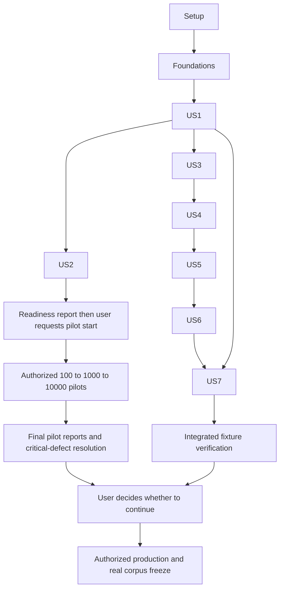

# Implementation Tasks: Vietnamese Multi-hop Fact-Checking

**Inputs:** [specs.md](specs.md), [plans.md](plans.md), [data-model.md](data-model.md), [contracts/interfaces.md](contracts/interfaces.md), [research.md](research.md), [research_vimqa.md](research_vimqa.md), [quickstart.md](quickstart.md).

**Status (2026-10-25):** T001–T048 implemented and verified with 81 passing offline backend tests. Authorized T049 pilot 100 is now complete and its source/artifact checks pass: 5 eligible, 65 unresolved extraction, 66 pending classification (overlapping outcomes). See [pilot 100 assessment](../reports/pilots/b0243673-5f0b-4ac6-b8b3-0ca7aa74ccc6/100/summary.md). Pilot 1,000 is not recommended until the identified issues are addressed; T050 onward and production remain unapproved. Snapshot: `2026-10-25T03:00:00Z` (10:00 Asia/Saigon).

**Offline remediation (2026-10-25):** The user's subsequent repair request is implemented and verified: **142 passing offline tests**; [root causes/results](../reports/verification/pilot100-remediation.md), [per-article audit](../reports/verification/pilot100-remediation-audit.json), [PowerShell handoff](pilot100-replay.md). Archived-cache extraction: 92 complete / 8 unresolved. Of 46 original truncated classifications, 7 become supported and 7 unsupported; 32 still have necessary open branches. Those figures describe the offline retrospective; the agent performed no source API calls during remediation. The user subsequently ran the new Pilot 100 successfully; see R100-6 and its replay assessment below. T050 and final-rule staged live validation remain unchecked.

### Pilot 100 repair checklist — authorized offline scope

- [x] R100-1 Audit all 65 unresolved articles and 55 diagnostic names; implement tested/versioned extraction rules, strict safe formatters and AST/list/sentence-boundary fixes.
- [x] R100-2 Audit all 46 truncated cases, including 27 containing roots; fix branch stopping/cycles/depth and preserve necessary sibling/subtype dependencies.
- [x] R100-3 Investigate all 20 maxlag cases and 3,956 request fan-out; implement tested persistent cooldown/failure caches, safe batching, current-run pending upsert and compatible historical reuse.
- [x] R100-4 Verify offline fixtures/full suite, raw-cache retrospective results and immutable old-run/report fingerprints; keep snapshot, eligibility, Lead-only Graph and exact 20,000 target.
- [x] R100-5 Deliver ordered new-run PowerShell commands, Tee-Object logs/exit codes, status/report export and retry/resume instructions; stop before a real rerun.
- [x] R100-6 User runs new Pilot 100 and supplies logs/reports for evaluation. Run `9c3ed5a4-f161-454c-8a3c-71fe69ed6c1e` completed with exit 0; [replay assessment](../reports/pilots/9c3ed5a4-f161-454c-8a3c-71fe69ed6c1e/assessment.md): 226.45 seconds, 92 complete extractions, 27 supported classifications, 43 structural pending, 16 eligible, 531 requests, 0 errors/retries. Same cohort/snapshot verified. Pilot 1,000 remains unapproved and is not recommended yet.

**Layout:** The repository uses the requested `docs/` artifacts, not an initialized `.specify` feature tree; there are no Spec Kit extension hooks or constitution to execute.

### Pilot 100 round-2 repair — authorized offline scope

- [x] R200-1 Diagnose all 43 truncated cases against round-2 SQLite/log/checkpoint/raw data; retain immutable baselines of both actual runs. See [repair ledger](../reports/verification/pilot2-remediation-ledger.md).
- [x] R200-2 Implement regression-tested cached fixed-point classification with precise unresolved reasons, safe stopping and preserved network bounds/taxonomy. Cached analysis of 43 cases: 20 supported, 17 proved unsupported, 6 terminal unresolved with two required QIDs absent.
- [x] R200-3 Inspect 8 unresolved extractions and verify retained content/sentence/link invariants for all 92 completed articles; fix demonstrated inline-list and normalized-label defects in article 3148970. Version `lead-3`; all 8 residuals remain quarantined.
- [x] R200-4 Verify Bridge/Comparison generation, ranking and Lead-only linkage with positive/negative fixtures; actual16 have no internal non-self lead edge or shared multi-article subtype/attribute block. Ranking unchanged; add pair audit.
- [x] R200-5 Complete 177 passing offline tests, independent review, preservation of both old runs and tested operator commands. See [acceptance](../reports/verification/pilot2-remediation.md), [per-article audit](../reports/verification/pilot2-remediation-audit.json) and [PowerShell handoff](pilot100-replay.md). No actual replay run, source API call or pilot executed by the agent; STOP.
- [ ] R200-6 User runs the next Pilot 100 and returns logs/reports. Pilot 1,000 remains unapproved.

## Execution Rules

- Follow the agreed spec and latest plan. Do not alter requirements to make tests, extraction yield, or quotas pass.
- Checklist format: task ID, optional `[P]`, optional user-story label, concrete action and file path. `[P]` means a task may run alongside another ready task touching different files; it does not eliminate dependencies or authorize spawning agents.
- Write the specified meaningful tests before the corresponding implementation; verify the intended failure, implement, then rerun. The spec/plan explicitly require verification. Passing fixture tests is not evidence that the real corpus or human benchmark is complete.
- Initial candidate target is 80,000, extensible; frozen corpus remains exactly 20,000. Pilot execution is bounded at 100 -> 1,000 -> 10,000 and does not publish a smaller production corpus.
- Keep one fixed snapshot, raw revision provenance, versioned rules, deterministic scores/order, and compatible cache reuse. Changed incompatible rules create a new run, never mutate the old one.
- Manual Pilot Start Gate: complete the required builder implementation and fixture tests, report readiness and stop before T049. Execute the 100 -> 1,000 -> 10,000 pilots only when the user explicitly requests them; implementation completion or this task list is not permission to start a pilot.
- Operational graph edges are retained Full Lead prose links only. Body/infobox/table links are excluded; hyperlinks alone are not factual evidence.
- Human label/hop authority, external NEI review, evidence-array schema, six-sentence UI, fresh page sessions, and session-only export remain unchanged.
- Never require two source articles. SUPPORTED/REFUTED require at least two distinct sentences and human hop count 2 or 3; NEI requires exactly one partial sentence and human hop count 2.
- Pause after final pilot reports for the user's production decision. No task runner may infer approval from completed reports, elapsed time, passing tests or this task list.
- File paths below describe implementation outputs to create or modify later. Reporting/assessment files are technical artifacts, not sample-review metadata.

## Phase 1: Project Setup

**Progress:** Complete T001–T006; see [setup verification](../reports/verification/setup.md). Frontend is scaffold only, without product features.

**Goal:** Establish reproducible development/test environments without fetching a corpus or changing annotation requirements.

- [x] T001 Create the backend package skeleton and entry point in `backend/pyproject.toml`, `backend/src/vimfc/__init__.py`, and `backend/src/vimfc/__main__.py`; select compatible Python dependencies and document the Python 3.12 baseline.
- [x] T002 [P] Create React/TypeScript/Vite setup in `frontend/package.json`, `frontend/tsconfig.json`, and `frontend/vite.config.ts`; configure build, typecheck, unit-test and Playwright scripts without generating product features.
- [x] T003 Lock compatible dependencies in `backend/requirements.lock` and `frontend/package-lock.json`; verify clean installation/import/build smoke checks and record Node/Vite compatibility in `README.md`.
- [x] T004 Create source-fixture and test configuration in `tests/conftest.py`, `tests/fixtures/manifest.json`, and `frontend/playwright.config.ts`; separate archived/controlled tests from opt-in real-network checks.
- [x] T005 [P] Extend `.gitignore` to exclude large source/corpus data, raw logs, caches, local databases/sidecars, bulk exports, virtual environments and build outputs while preserving `.agents/`. Keep necessary curated reproducibility/acceptance reports in `reports/verification/` and pilot assessment summaries (for example `reports/pilots/<run_id>/assessment.md` and cohort `summary.md`/compact `summary.json`) committable through explicit scoped rules; do not blanket-ignore their parent directories or allow large raw telemetry through summary exceptions. Document artifact/allowlist boundaries and portable corpus delivery in `README.md`.
- [x] T006 Review `docs/research_vimqa.md` and `docs/research.md` against the implementation boundaries; record source/fixture acquisition provenance in `tests/fixtures/manifest.json` without attributing this project's adaptations to ViMQA.

**Checkpoint:** Dependency smoke checks succeed, test discovery works, and no corpus/pilot is started during setup.

## Phase 2: Foundational Contracts and Storage

**Progress:** Complete T007–T014; fingerprint/storage/CLI/provider foundation checks: 9 passed. See [execution ledger](../reports/verification/implementation-ledger.md).

**Goal:** Provide shared types, fingerprints, transactional storage and fixtures required by all stories.

- [x] T007 Define `SourceRevisionRef`, `RawRevision`, extraction/classification/pair/selection results, evidence keys and benchmark records in `backend/src/vimfc/domain.py`; preserve exact evidence fields and human annotation values.
- [x] T008 [P] Create versioned defaults in `configs/pipeline.json`, `configs/classification_rules.json`, `configs/extraction_rules.json`, and `configs/ranking_rules.json`; include the eight quotas, 80,000 initial target, snapshot input, partner caps and integer weights from the plan.
- [x] T009 Write fingerprint/transaction/migration tests in `tests/unit/test_fingerprints.py` and `tests/integration/test_storage.py`; assert stable canonical hashes, atomic completed-stage results, preserved previous runs and non-destructive annotation migrations.
- [x] T010 Implement writable builder/annotation schema creation and explicit transaction helpers in `backend/src/vimfc/storage/migrations.py` and `backend/src/vimfc/storage/pipeline_store.py`, with the tables/indexes in `docs/data-model.md`, one writer and foreign keys enabled.
- [x] T011 Implement raw cache object writes, hashes and snapshot/revision/stage lookup keys in `backend/src/vimfc/storage/raw_cache.py`; use compressed atomic files and distinguish durable raw reuse from version-dependent derived results.
- [x] T012 Create archived historical wikitext, Wikidata JSON, move/redirect, template and source-error fixtures under `tests/fixtures/`; include cross-document and single-document examples without treating synthetic fixtures as research data.
- [x] T013 Implement CLI skeleton, exit codes, config loading and immutable run fingerprints in `backend/src/vimfc/cli.py`; distinguish incompatible configuration, invalid arguments, operational failure and insufficient eligible supply.
- [x] T014 Verify foundation tests with `python -m pytest tests/unit/test_fingerprints.py tests/integration/test_storage.py`; record expected interface/schema contracts in `docs/contracts/interfaces.md` only if an implementation detail needs clarification consistent with the plan.

**Checkpoint:** Shared storage/types are usable. No annotation semantic validator or automatic label/hop logic exists.

## Phase 3: US1 - Build and Freeze the Reproducible Corpus (P1)

**Progress:** Complete T015–T038 against controlled fixtures; see [US1 verification](../reports/verification/us1.md). No real research corpus has been collected or frozen.

**Goal:** Implement snapshot acquisition, Full Lead extraction, classification, pair-aware selection and immutable corpus publication.

**Prerequisites:** T001-T014. This phase implements freeze capability against fixtures; actual production acquisition/freeze is reserved for the gated final phase.

**Independent test:** Controlled historical inputs produce deterministic selection results and a valid standalone package only when exactly 20,000 eligible identities exist. Timestamp, extraction, graph and provenance violations prevent publication.

### Tests Before Implementation

- [x] T015 [P] [US1] Write historical acquisition tests in `tests/integration/test_snapshot_sources.py` for cutoff revision selection, one-page historical queries, known-revision batches, missing/deleted history, HTTP-200 maxlag and Retry-After.
- [x] T016 [P] [US1] Write historical identity tests in `tests/unit/test_identities.py` for moved titles, snapshot redirects, loop/depth bounds, ambiguous target ownership and current mappings that differ from historical ones.
- [x] T017 [P] [US1] Write lead/sentence tests in `tests/unit/test_extract.py` and `tests/unit/test_sentences.py` for multi-paragraph prose, heading boundaries, excluded components, NFC, abbreviations, unknown factual templates and direct lead-link provenance.
- [x] T018 [P] [US1] Write classification/quality tests in `tests/unit/test_classify.py` and `tests/unit/test_quality.py` for historical item association, P31/P279/P106 dependency closure, group overlap, unclassified outcomes and versioned eligibility rules.
- [x] T019 [P] [US1] Write pair/ranking tests in `tests/unit/test_pairs.py` and `tests/unit/test_rank.py` for compatible attributes, directed bridges, bounded deterministic partners, negative/positive scores and shortcut/redundancy signals.
- [x] T020 [P] [US1] Write selection tests in `tests/unit/test_select.py` for stable ties, useful partner retention, soft quotas, subtype diversity, hub penalties, exact cardinality and insufficient supply without threshold relaxation.
- [x] T021 [P] [US1] Write freeze tests in `tests/integration/test_freeze.py` for 19,999/20,000/20,001 selections, metadata/revision errors, sentence gaps, body-only edges, standalone transfer and refusal to overwrite a frozen version.

### Implementation

- [x] T022 [US1] Implement the shared MediaWiki client in `backend/src/vimfc/source/mediawiki.py`: persistent connections, User-Agent/contact, full continuation objects, one request per host, maxlag, typed errors and bounded retries; run T015 tests.
- [x] T023 [US1] Implement `select_revision` and `fetch_revisions` in `backend/src/vimfc/source/revisions.py`; verify timestamps/content IDs/hashes, cache historical lookups, batch known contents and never replace absent history with live content.
- [x] T024 [US1] Implement snapshot title/redirect resolution in `backend/src/vimfc/source/identities.py`; preserve move/redirect provenance, normalized page identities and unresolved targets, with no invented graph edges; run T016 tests.
- [x] T025 [US1] Implement historical Wikidata access in `backend/src/vimfc/source/wikidata.py`; validate historical sitelinks and cache referenced class/occupation revisions under the same snapshot rather than using live metadata.
- [x] T026 [US1] Implement deterministic category/namespace candidate streams in `backend/src/vimfc/pipeline/collect.py`; archive discovery order/cursors, deduplicate canonical identities and support the initial 80,000 manifest plus same-snapshot extensions.
- [x] T027 [US1] Implement `extract_lead` in `backend/src/vimfc/pipeline/extract.py` using historical raw AST nodes, retained prose/link boundaries and the configured argument-only historical-safe formatters; unresolved factual templates quarantine the article rather than truncate its meaning.
- [x] T028 [US1] Implement paragraph/statistics storage and deterministic sentence splitting in `backend/src/vimfc/pipeline/sentences.py`; assign contiguous zero-based IDs and preserve exact normalized text under a versioned extractor; run T017 tests.
- [x] T029 [US1] Implement historical group/subtype classification in `backend/src/vimfc/pipeline/classify.py` and reviewed QID mappings in `configs/classification_rules.json`; retain revision-backed paths, overlap precedence and explicit truncation/unclassified reasons; run T018 tests.
- [x] T030 [US1] Implement eligibility and factual-quality signals in `backend/src/vimfc/pipeline/quality.py` and `configs/extraction_rules.json`; record every rejection and treat documented thresholds as versioned settings, not silent quantity-driven adjustments.
- [x] T031 [US1] Implement sparse bridge/comparison blocks in `backend/src/vimfc/pipeline/pairs.py`; use lead-only relations and compatible lead attributes, cap ranking partners without truncating the complete operational lead-link data; run pair-generation tests.
- [x] T032 [US1] Implement fixed-point features/scores in `backend/src/vimfc/pipeline/rank.py`; retain feature contributions, source sentence/rule provenance, omitted-pair counts and score versions; do not generate claims or infer human hops.
- [x] T033 [US1] Implement graph-aware deterministic greedy selection in `backend/src/vimfc/pipeline/select.py`; maintain incremental partner/group/subtype gains, sparse adjacency, stable page-ID tie breaks and exact-20,000 or shortage outcomes; run T020 tests.
- [x] T034 [US1] Implement corpus report generation in `backend/src/vimfc/pipeline/report.py`: connectivity, subtype/group deviations, bridge/comparison counts and external reviewed/valid yield ingestion; keep yield unassessed when no actual human assessment exists.
- [x] T035 [US1] Implement immutable package construction in `backend/src/vimfc/pipeline/freeze.py`; validate source/extraction/graph invariants, store all selected prose/sentences and outside lead targets, derive internal directed edges, close/checkpoint storage and atomically publish a new standalone database/manifest.
- [x] T036 [US1] Implement corpus read/verify primitives in `backend/src/vimfc/storage/corpus_store.py`; open `mode=ro`, check version/count/hash/integrity and never use `immutable=1` without an actual immutability guarantee.
- [x] T037 [US1] Wire builder/verify/report commands in `backend/src/vimfc/cli.py` to the implemented interfaces, keeping cohort execution bounded by the orchestration added in US2; no CLI path may implicitly initiate production.
- [x] T038 [US1] Run the US1 fixture suites and record results in `reports/verification/us1.md`; prove lead-only internal edges, replayed selection and portable frozen fixture storage, explicitly stating that real corpus collection remains incomplete.

## Phase 4: US2 - Resume, Measure Pilots, and Gate Production (P1)

**Progress:** T039–T049 complete, including the authorized real pilot 100 and its [verified assessment](../reports/pilots/b0243673-5f0b-4ac6-b8b3-0ca7aa74ccc6/100/summary.md). Phase remains open: T050–T053 are unchecked and unapproved. Stop after pilot 100; investigate extraction/classification yield before scaling.

**Goal:** Make collection interruptible/idempotent, instrument performance and template quality, and enforce the user-controlled production transition.

**Prerequisites:** US1 interfaces through T037. Independent fixture verification does not require production or a real frozen corpus.

**Independent test:** Interrupted compatible runs reuse valid work; incompatible runs preserve old outputs and fail clearly. Pilot commands stop at their requested cohort, produce auditable metrics and cannot cross into production automatically.

- [x] T039 [P] [US2] Write interruption/resume tests in `tests/integration/test_resume.py` for durable blob vs stage commit, expired leases, duplicate candidate prevention, persisted retry eligibility, changed fingerprints and raw-only reuse in a new run.
- [x] T040 [P] [US2] Write pilot-gate/report tests in `tests/integration/test_pilot_controls.py` for 100/1,000/10,000 bounds, staged cohort progression, missing/stale report rejection, critical defects and no production calls after pilot completion.
- [x] T041 [P] [US2] Write metrics/template-audit tests in `tests/unit/test_pilot_report.py` for correct denominators, cached vs new work, overlapped elapsed time, distinct affected-template article counts and provisional extraction outputs excluded from validated data.
- [x] T042 [US2] Implement stage dependency fingerprints, worker leases, atomic result/state commits and compatible resume in `backend/src/vimfc/pipeline/runner.py` and `backend/src/vimfc/storage/pipeline_store.py`; rerun T039 tests.
- [x] T043 [US2] Implement retry/requeue and incompatible-run reuse commands in `backend/src/vimfc/cli.py`; preserve old config/results, reuse only matching inputs and ensure retry/extend cannot escape pilot bounds or start unapproved production.
- [x] T044 [US2] Add bounded-stage orchestration, request/cache/error counters and rolling progress/ETA in `backend/src/vimfc/pipeline/runner.py` and `backend/src/vimfc/pipeline/report.py`; distinguish candidate work from dependency requests and rejection outcomes.
- [x] T045 [US2] Implement pilot CPU/RAM/disk sampling and report serialization in `backend/src/vimfc/pipeline/report.py`, with required instrumentation dependencies in `backend/pyproject.toml`; record machine environment, sampling interval, stage time/throughput, cache/retry/error rates and qualified 80,000 ETA assumptions.
- [x] T046 [US2] Implement per-pilot template diagnostics in `backend/src/vimfc/pipeline/extract.py` and `backend/src/vimfc/pipeline/report.py`; report success/unresolved counts, top failing templates and archived examples, plus effects on complete leads, sentence IDs and lead graph.
- [x] T047 [US2] Implement `pipeline pilot`, pilot report selection and deliberate `--production --pilot-report` enforcement in `backend/src/vimfc/cli.py`; persist reviewed report/run/version identity without treating report completion as the user's decision.
- [x] T048 [US2] Verify all resume/gate/metrics fixture suites and save results in `reports/verification/us2.md`; assert no pilot diagnostics bypass the real 20,000 freeze gate and no stale-rule report authorizes production.

### Manual Pilot Start Gate - Before T049

Complete the builder implementation and required fixture tests through T048, summarize readiness, test evidence and remaining issues in `reports/verification/pilot-readiness.md`, report the status to the user and **stop**. T049 and subsequent real pilot execution remain blocked until the user explicitly requests starting the 100 -> 1,000 -> 10,000 pilots. Do not start pilot requests through a helper, scheduler, retry, test command or automatic continuation merely because implementation is ready. Record the user's request before proceeding; do not manufacture it or infer it from elapsed time.

This gate authorizes neither production nor a smaller frozen corpus. The separate **Production Approval Gate at T097 remains unchanged** and still requires the user's later decision after reviewing final pilot results.

- [x] T049 [US2] Only after the Manual Pilot Start Gate is released by the user's explicit request, run the bounded 100-candidate cohort and save its performance/template audit in `reports/pilots/<run_id>/100/`; use the fixed snapshot and stop at the cohort boundary.
- [ ] T050 [US2] Run the bounded 1,000-candidate cohort and save readable/machine-readable reports in `reports/pilots/<run_id>/1000/`; identify bottlenecks and provide stage timing, articles/minute, API/cache/retry/error counts/rates, CPU/RAM/disk and uncertainty-qualified production ETA.
- [ ] T051 [US2] If common unsupported factual templates need support, add tested historical-safe formatters in `backend/src/vimfc/pipeline/extract.py` and `tests/unit/test_extract.py`; create a new versioned run, reuse compatible raw data and regenerate affected extraction/graph/filter/pair/rank/selection and pilot reports before claiming final-rule validation.
- [ ] T052 [US2] Run the bounded 10,000-candidate cohort with the final evaluated rules and save reports in `reports/pilots/<run_id>/10000/`; assess scaling, stability, checkpoint/resume and pair quality, with no live-template substitution or automatic production expansion.
- [ ] T053 [US2] Summarize final pilot evidence, bottlenecks, remaining risks and critical-defect resolution in `reports/pilots/<run_id>/assessment.md`, present it to the user and **stop**; leave production tasks blocked until an explicit decision to continue is received.

**Mandatory stop:** T053 does not authorize 80,000 production. Other offline implementation tasks may continue when independently requested/authorized; production collection cannot.

## Phase 5: US3 - Start and Share the Local Application (P1)

**Goal:** Provide one-command Windows startup and a read-only portable corpus with separate local sample storage.

**Prerequisites:** Foundations and US1 corpus reader/package interfaces. Use a validated controlled corpus fixture for development; real-package handoff is verified only after gated production.

**Independent test:** Valid package starts; missing prerequisites/unfrozen/corrupt package refuses startup; the same portable package is readable on a second installation without copying writable sample storage.

- [ ] T054 [P] [US3] Write read-only/package validation tests in `tests/integration/test_local_startup.py` for article count/hash/schema, unchanged corpus bytes, absent WAL dependencies and independent annotation stores bound to the same corpus version.
- [ ] T055 [P] [US3] Write Windows launcher tests in `tests/integration/test_windows_launcher.py` for missing tools/dependencies, occupied ports, readiness timeout, hidden helpers, preserving existing databases and cleaning up only owned processes.
- [ ] T056 [US3] Implement annotation DB initialization/binding in `backend/src/vimfc/storage/annotation_store.py`; create only if absent, migrate non-destructively and reject corpus-version mismatch without touching frozen data.
- [ ] T057 [US3] Implement application lifespan, readiness and corpus summary in `backend/src/vimfc/api/app.py`; use the read-only corpus reader and validation cache, serve static frontend output and exclude source-network client dependencies.
- [ ] T058 [US3] Implement explicit dependency setup in `scripts/install.ps1` and one-command production-local/dev launch in `start.ps1`; check package/readiness/ports and print the confirmed localhost URL, never collect corpus or silently reinstall/replace data.
- [ ] T059 [US3] Implement the minimal Vietnamese application shell in `frontend/src/App.tsx` and package-path local settings documented in `README.md`; ordinary launch serves built output while explicit dev mode uses Vite.
- [ ] T060 [US3] Verify startup/portable fixture tests and record results in `reports/verification/us3.md`; seed stored sessions/samples through controlled storage fixtures to check restart preservation without depending on the later Submit endpoint or calling fixture delivery a completed research corpus.

## Phase 6: US4 - Local Discovery and Workspace Management (P1)

**Goal:** Explore only local frozen articles from any open source, with exact graph/entity/subtype relationships and a maximum-five workspace.

**Prerequisites:** US3 app/read-only corpus reader and shared types. No dependency on live collection during annotation.

**Independent test:** All three discovery modes return only eligible in-corpus candidates; add/remove/random/display operations preserve source data and draft evidence correctly.

- [ ] T061 [P] [US4] Write local discovery tests in `tests/integration/test_discovery.py` for lead-only directed links, external shared entities, historical alias identity, exact subtype filters, pagination and random sampling over the whole eligible set.
- [ ] T062 [P] [US4] Write workspace reducer tests in `frontend/src/workspace.test.ts` for duplicate/sixth-article rejection, Article A, six-sentence display, hidden selected sentences and cancellation/confirmation of Remove/Re-random.
- [ ] T063 [US4] Implement indexed article/random/entity/subtype/candidate queries in `backend/src/vimfc/storage/corpus_store.py`; use dense article ordinals, source/target indexes and canonical identities with no network fallback.
- [ ] T064 [US4] Implement article/shared-entity/discovery endpoints in `backend/src/vimfc/api/articles.py` and `backend/src/vimfc/api/schemas.py`; enforce valid source filters, stable cursors, exclusions and distinct empty/error responses; run T061 tests.
- [ ] T065 [US4] Implement typed local transport in `frontend/src/api.ts` and ephemeral workspace reducer in `frontend/src/workspace.ts`; use page/revision/sentence keys and retain selections when articles collapse.
- [ ] T066 [US4] Implement article cards and discovery controls in `frontend/src/components/ArticleCard.tsx` and `frontend/src/components/DiscoveryPanel.tsx`; allow expansion from any open article, manual/Random Candidate choice, Show More/Show Less and correct subtype/shared-entity selection.
- [ ] T067 [US4] Wire the workspace and confirmation actions in `frontend/src/App.tsx` and `frontend/src/styles.css`; Article A has no Remove, selected sentences have light blue background, and failed/cancelled actions preserve state.
- [ ] T068 [US4] Run backend/reducer/browser discovery tests and write `reports/verification/us4.md`; include offline external-network denial and frozen corpus hash comparison after workspace operations.

## Phase 7: US5 - Human Annotation and Atomic Submit (P1)

**Goal:** Persist the human's exact annotation values and authoritative selected evidence with derived coverage and idempotent Submit.

**Prerequisites:** US3 storage/app and US4 article/selection contracts. Session creation is supplied here for Submit and page lifecycle is finalized in US6.

**Independent test:** Each label follows its evidence-array/count rule, including valid single-document SUPPORTED/REFUTED. Replays create one record, conflicts do not overwrite, and failed persistence retains the draft.

- [ ] T069 [P] [US5] Write annotation API/service tests in `tests/integration/test_annotation_api.py` for strict human fields, same-document two sentences, three-hop with two sentences, NEI exactly one partial sentence, source mismatch/duplicate references and nonblank claims.
- [ ] T070 [P] [US5] Write idempotency/storage tests in `tests/integration/test_submit_transactions.py` for double-click/races, lost acknowledgement, equal replay, changed-payload conflict and rollback before/after evidence/receipt insertion.
- [ ] T071 [P] [US5] Write annotation reducer/form tests in `frontend/src/components/AnnotationForm.test.tsx` for unselected initial label/hops, final human label routing, failure preservation, hidden evidence and success-only reset.
- [ ] T072 [US5] Implement session creation/read/count storage and endpoints in `backend/src/vimfc/storage/annotation_store.py` and `backend/src/vimfc/api/sessions.py`; generate local UUIDs and count only committed session samples.
- [ ] T073 [US5] Implement strict Submit request/record models in `backend/src/vimfc/api/schemas.py`; accept evidence identities rather than authoritative browser text and reject unsupported label/hop/source data without coercing human selections.
- [ ] T074 [US5] Implement `submit_sample` structural validation/source loading in `backend/src/vimfc/annotation/service.py`; enforce the agreed sentence counts, reconstruct exact evidence objects, keep reasoning_chain null and derive coverage solely from distinct source page IDs.
- [ ] T075 [US5] Implement one-transaction sample/evidence/receipt persistence in `backend/src/vimfc/storage/annotation_store.py`; digest canonical payloads, replay equal requests and reject changed requests under the same submission ID; run T070 tests.
- [ ] T076 [US5] Implement Submit responses in `backend/src/vimfc/api/samples.py` with committed counters, 201 creation/200 replay and typed 409/validation/storage errors; run T069 tests without any semantic or hop inference.
- [ ] T077 [US5] Implement client logical submission IDs, unchanged-payload retries and in-flight guards in `frontend/src/api.ts`; edited drafts receive new identities rather than overwriting an earlier submitted request.
- [ ] T078 [US5] Implement the three-field human annotation form and checkbox Submit integration in `frontend/src/components/AnnotationForm.tsx` and `frontend/src/workspace.ts`; clear only human fields/selections after backend success and preserve workspace/display/discovery on success or failure as specified.
- [ ] T079 [US5] Publish concise Vietnamese hop-count/necessity/cross-document guidance in `frontend/src/components/AnnotationGuidance.tsx`, using the examples in `docs/docs.md`; do not add review controls, extra input fields or new validation requirements.
- [ ] T080 [US5] Verify API/storage/form tests and browser lost-response/rollback scenarios in `tests/e2e/submit.spec.ts`; record exact human-value/evidence/coverage preservation in `reports/verification/us5.md`.

## Phase 8: US6 - Fresh Page Sessions and Durable Samples (P1)

**Goal:** A page opening/refresh starts empty with a new session while earlier committed samples remain recoverable.

**Prerequisites:** US5 session/sample endpoints and workspace form state.

**Independent test:** Submit, create a draft, refresh/reopen, and verify new UUID/empty state with unchanged historical samples. Two machine stores remain independent.

- [ ] T081 [P] [US6] Write lifecycle tests in `tests/e2e/sessions.spec.ts` for fresh UUIDs, StrictMode/bootstrap behavior, empty workspace/unselected fields, current-session-only counters and intentional non-restoration of drafts.
- [ ] T082 [US6] Implement once-per-page bootstrap in `frontend/src/api.ts` and `frontend/src/App.tsx`; create the session outside duplicated component effects, use no localStorage/session restoration, and wait for valid corpus/session readiness.
- [ ] T083 [US6] Integrate committed sample counter and current session display in `frontend/src/components/Header.tsx`; never optimistically count an uncertain Submit or show previous-session counts as current.
- [ ] T084 [US6] Verify restart/refresh durability and independent local stores in `tests/integration/test_session_persistence.py` and `tests/e2e/sessions.spec.ts`; record results in `reports/verification/us6.md` with no annotator-ID/synchronization requirement.

## Phase 9: US7 - Current/Historical Session Export and Corpus Artifacts (P1)

**Goal:** Export exact saved records and separately reuse the entire frozen corpus/graph without changing annotation state.

**Prerequisites:** US5 records/storage, US6 current session, US1 corpus package/export provenance.

**Independent test:** Parse each exported line and compare with committed samples; historical CLI export recovers old sessions; corpus exports include all 20,000 selected articles and lead-only internal edges.

- [ ] T085 [P] [US7] Write export contract tests in `tests/integration/test_exports.py` for UTF-8/no BOM, both evidence arrays, unchanged six evidence fields, null reasoning chain, coverage, record order and exclusion of drafts/unselected/other-session data.
- [ ] T086 [P] [US7] Write corpus/session CLI tests in `tests/integration/test_cli_exports.py` for all-article export, versioned internal edges, unknown/empty sessions, atomic output files and read-only source bytes.
- [ ] T087 [US7] Implement the common benchmark serializer and consistent-read session iterator in `backend/src/vimfc/annotation/export.py`; preserve exact human values/source text and omit internal receipts, review metadata and annotator IDs.
- [ ] T088 [US7] Implement JSONL session download in `backend/src/vimfc/api/samples.py`; use session-derived filename, documented content type, empty-session error and no date filtering or destructive side effects.
- [ ] T089 [US7] Implement session listing/historical sample export commands in `backend/src/vimfc/cli.py` using the common serializer and temporary-output publication; run CLI and export tests.
- [ ] T090 [US7] Implement independent complete corpus/graph exports through `backend/src/vimfc/pipeline/freeze.py` and `backend/src/vimfc/cli.py`; include all selected articles, stable IDs/corpus version and only internal retained-lead directed edges.
- [ ] T091 [US7] Add current-session Export Dataset behavior to `frontend/src/components/Header.tsx` and `frontend/src/api.ts`; disable for zero committed samples, retain workspace on success/failure and allow continued annotation.
- [ ] T092 [US7] Run browser export/recovery scenarios in `tests/e2e/export.spec.ts` and backend/CLI suites; save results in `reports/verification/us7.md`, comparing line counts and evidence objects with durable records.

## Phase 10: Cross-cutting Verification and Gated Production Delivery

**Goal:** Finish documentation/packaging, verify the integrated local app, then proceed with real collection only if the user approves the final pilot assessment.

- [ ] T093 Finalize `README.md` and `docs/quickstart.md` with explicit installation, separate builder/annotation commands, fixed snapshot/version rules, pilot reports/stop point, source-vs-sample distinction and historical-session recovery.
- [ ] T094 Run locked backend/unit/integration, frontend typecheck/unit/build and Playwright suites; record actual results and any unresolved defects in `reports/verification/acceptance.md`, not inferred success from earlier task checkboxes.
- [ ] T095 Validate Windows missing-prerequisite/port-conflict/readiness/cleanup paths and standalone corpus fixture transfer in `tests/integration/test_windows_launcher.py`; document measured startup/local-query results in `reports/verification/acceptance.md`.
- [ ] T096 Review `reports/pilots/<run_id>/assessment.md` against final 1,000/10,000 performance/template reports and current rule hashes; correct critical defects through tested changes/new compatible-design runs and regenerate affected reports before asking for production continuation.
- [ ] T097 Record the user's explicit decision to continue in `reports/pilots/<run_id>/production-decision.md`, linking final report/snapshot/config identities; **user-dependent gate**: leave this and T098-T101 blocked until approval arrives, and never generate an approval on the user's behalf.
- [ ] T098 After T097 only, deliberately invoke authorized production collection using `backend/src/vimfc/cli.py` and record progress in `reports/production/<run_id>/`; target 80,000 candidates, resume safely and extend same-snapshot supply if needed without reducing quality.
- [ ] T099 After authorized production reaches sufficient eligible supply, validate/freeze the real exactly-20,000 corpus with `backend/src/vimfc/pipeline/freeze.py`; publish `data/corpora/<corpus_version>/corpus.sqlite` and `manifest.json`, preserving selected IDs, source/graph metadata and audit records.
- [ ] T100 Validate actual corpus/graph exports and offline app behavior through `docs/quickstart.md`; transfer source/locks/frozen package to the second Windows installation, retain independent samples/sessions and record matching corpus hashes in `reports/production/<run_id>/acceptance.md`.
- [ ] T101 Publish real-data validation evidence in `reports/production/<run_id>/acceptance.md`, including pilot reports, count/version/hash, graph checks and remaining source issues; distinguish software/corpus completion from the separately human-authored 2,000-claim benchmark and external Valid 2-hop Yield assessment.

## Dependencies and Completion Order

All seven user stories retain the spec's P1 priority. Dependencies determine implementation order; they do not imply that collection, annotation and exports are independent subsystems.

| Phase / story | Required inputs | Completion evidence |
| --- | --- | --- |
| Setup | Existing design documents | Installed/locked environments and test discovery |
| Foundations | Setup | Stable types, fingerprints, transaction behavior and fixtures |
| US1 | Foundations | Historical acquisition/extraction/classification/pair/freeze fixture suites |
| US2 | US1 stage interfaces; explicit user request before T049 pilot execution | Resume tests, readiness report/manual start stop, then authorized bounded pilot reports and production stop |
| US3 | Foundations + US1 package/reader | Windows startup, portable read-only data, independent writable storage |
| US4 | US3 + corpus graph/subtypes | Local discovery and workspace behavior |
| US5 | US3 storage + US4 evidence identities | Structural Submit, human authority, atomic receipts, derived coverage |
| US6 | US5 sessions/records + workspace | New page session, no drafts, durable previous samples |
| US7 | US1 package + US5/US6 samples/sessions | Exact session and independent corpus/graph exports |
| Cross-cutting | Story implementation and final pilot evidence | Integrated tests/README, then user production decision |
| Real production delivery | T097 explicit decision + no critical defects | Exactly 20,000 real articles, same-version offline/transfer evidence |



Ordinary annotation startup requires a valid frozen 20,000-article package. Tests may construct controlled packages to verify behavior; they must not weaken production validation or be passed off as the research corpus. Real collection/freeze stays in T098-T101 even if US1 freeze implementation is complete.

## Parallel Execution Examples

Parallelism is optional and limited to ready tasks with disjoint outputs. Tasks modifying shared CLI, models, database repositories, reducer or App files remain sequential. Examples below are scheduling opportunities, not delegation requests.

| Story | Safe example | Barrier before integration |
| --- | --- | --- |
| US1 | T015 source tests with T016 identity tests and T019 pair tests | Foundations ready; corresponding implementation follows tests |
| US2 | T039 resume tests with T040 gate tests and T041 report tests | US1 contracts ready; runner/report/CLI implementation sequential |
| US3 | T054 corpus/startup tests with T055 launcher tests | Package/storage interfaces ready; lifespan/launcher integrated afterward |
| US4 | T061 backend discovery tests with T062 frontend reducer tests | Shared identity contracts ready; client/backend behavior reconciled before browser acceptance |
| US5 | T069 API tests with T070 storage tests and T071 form tests | Types/Submit contract fixed; service/persistence/routes wired in order |
| US6 | Browser fixture preparation in `tests/e2e/sessions.spec.ts` and independent storage-fixture preparation in `tests/integration/test_session_persistence.py` | Session endpoint and workspace contracts already exist; App/Header edits sequential |
| US7 | T085 serializer tests with T086 CLI tests | Record contract stable; common serializer implemented before HTTP/CLI consumers |

## Verification Commands

Run from the installed environment; these are future commands, not commands executed during task generation:

```powershell
python -m pytest tests/unit tests/integration
npm --prefix frontend run typecheck
npm --prefix frontend run test
npm --prefix frontend run build
npm --prefix frontend run test:e2e
```

Use focused story suites while iterating, then the cross-cutting checks after integration. Pilot reports and production commands follow the exact contracts in `docs/contracts/interfaces.md`. A completed pilot must stop for the user's decision; standard test commands must not start real network collection automatically.

## Requirement Traceability

| Requirements | Task ownership |
| --- | --- |
| FR-001–005 | T006, T038, T079, T093–T101 and execution constraints |
| FR-006–009 | T007–T013, T015–T016, T022–T026, T039–T043 |
| FR-010–014 | T017–T018, T027–T030, T046, T051 |
| FR-015–021 | T019–T021, T031–T038, T052, T090, T099–T101 |
| FR-022–026 | T008, T026, T039–T053, T096–T098 |
| FR-027–028 | T021, T035–T038, T054, T090, T099–T100 |
| FR-029–030, FR-032–035 | T061, T063–T068 |
| FR-031, FR-036–037 | T062, T065–T068 |
| FR-038–045 | T069–T080 |
| FR-046–048 | T006, T079–T080 |
| FR-049–053 | T069–T070, T074–T077, T080 |
| FR-054–056 | T071–T072, T078, T081–T084 |
| FR-057–060 | T085–T089, T091–T093 |
| FR-061 | T035, T086, T090, T099–T100 |
| FR-062–065 | T054–T060, T093–T095, T100 |
| FR-066 | T006, T093 |
| PLAN B: performance pilot | T040–T045, T047–T050, T052–T053, T096–T098 |
| PLAN C: template audit | T017, T027–T028, T041, T046, T049–T053, T096 |

## Implementation Strategy and MVP Boundary

1. Build the source/storage/extraction/ranking/freeze capability and resumable pilot controls first (Setup, Foundations, US1/US2). The first reviewable increment is a **pilot-ready builder**, not a completed 20,000-article corpus.
2. Implement local startup and annotation stories against validated controlled fixtures while keeping production corpus checks intact. This allows software verification without silently initiating 80,000 collection.
3. Complete builder implementation and fixture tests, report readiness and stop at the Manual Pilot Start Gate before T049. Only when the user requests pilot execution, run 100 -> 1,000 -> 10,000, repair supported templates through tested/versioned changes, regenerate affected reports and stop again for the production decision at T097.
4. After explicit production approval, collect sufficient real candidates and freeze the actual corpus. Validate offline annotation and second-machine transfer against that package.
5. Human claim writing, semantic verification and benchmark completion remain separate research work. Task completion must never be inferred from software tests or heuristic pair counts.

The end-to-end research MVP is the real frozen corpus plus local human annotation and exact exports. Agentic RAG implementation, automatic claim/label/hop generation, app review workflows and benchmark split design remain out of scope.
